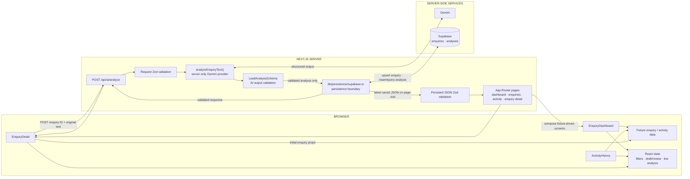
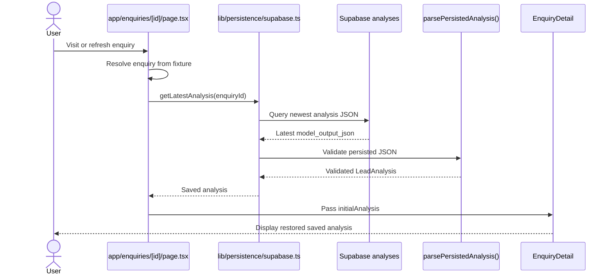
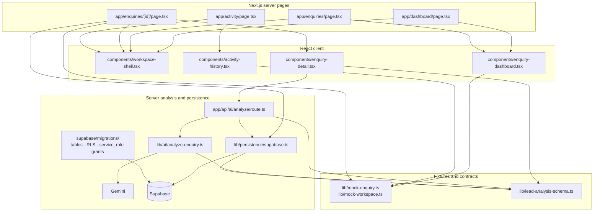

# Architecture map

## 1. Current system architecture



- The dashboard queue and workspace activity feed remain fixture-driven; fixture enquiries also provide the detail page's source enquiry.
- A new analysis is persisted only after Zod validation, then returned to temporary client state. On a later visit/refresh, the server loads and validates the newest saved analysis before rendering the detail UI.
- Gemini and Supabase are called from server-side code. The browser receives neither the Gemini API key nor the Supabase secret key.

## 2. “Analyse with AI” execution sequence

```mermaid
sequenceDiagram
  actor User
  participant UI as Browser: EnquiryDetail
  participant API as Next.js: POST /api/ai/analyze
  participant Request as Request Zod validation
  participant Provider as Server: analyzeEnquiryText()
  participant Gemini as Gemini provider
  participant Output as LeadAnalysisSchema
  participant DB as Supabase persistence

  User->>UI: Click “Analyse with AI”
  UI->>UI: Validate request and POST enquiry ID + text
  UI->>API: POST JSON
  API->>Request: Validate request and match fixture
  Request-->>API: Validated request
  API->>Provider: analyzeEnquiryText(originalText)
  Provider->>Gemini: Request structured output
  Gemini-->>Provider: Structured JSON
  Provider->>Output: Parse and validate AI output
  Output-->>Provider: Validated LeadAnalysis
  Provider-->>API: Validated analysis
  API->>Output: Validate response wrapper
  API->>DB: Persist validated analysis
  DB-->>API: Save succeeds
  API-->>UI: Validated analysis response
  UI->>UI: Validate response; setLiveAnalysis()
  UI-->>User: Render saved result
```

Persistence occurs only after Gemini output passes `LeadAnalysisSchema` validation. The client stores the successful response in React state for the current view; the database copy is what supports later restoration.

## 3. Page refresh / restore sequence



The server loads the latest persisted Analysis on each detail-page visit, so the view does not depend on the previous browser's React state.

## 4. File dependency map



- `lib/mock-workspace.ts` remains the source for fixture-driven queue and activity data.
- `lib/lead-analysis-schema.ts` validates provider output, API contracts, and restored persisted JSON.
- The migrations create `enquiries` and `analyses`, enable RLS, and grant the server role the privileges required by persistence.

## Read these files in this order

1. [app/enquiries/[id]/page.tsx](./app/enquiries/[id]/page.tsx) — see fixture lookup and server-side restore of a saved analysis.
2. [lib/persistence/supabase.ts](./lib/persistence/supabase.ts) — follow save and latest-analysis query boundaries.
3. [components/enquiry-detail.tsx](./components/enquiry-detail.tsx) — follow restored props, AI request, and local result state.
4. [app/api/ai/analyze/route.ts](./app/api/ai/analyze/route.ts) — trace request validation, validated persistence, and response.
5. [lib/ai/analyze-enquiry.ts](./lib/ai/analyze-enquiry.ts) — inspect the server-only Gemini structured-output call.
6. [lib/lead-analysis-schema.ts](./lib/lead-analysis-schema.ts) — review shared analysis and persisted-JSON contracts.
7. [supabase/migrations/20261007130000_enquiries_and_analyses.sql](./supabase/migrations/20261007130000_enquiries_and_analyses.sql) and [supabase/migrations/20261007140000_grant_enquiries_select.sql](./supabase/migrations/20261007140000_grant_enquiries_select.sql) — inspect the schema and server-role grants.
8. [lib/mock-workspace.ts](./lib/mock-workspace.ts), [components/enquiry-dashboard.tsx](./components/enquiry-dashboard.tsx), and [components/activity-history.tsx](./components/activity-history.tsx) — compare the still fixture-driven list and activity screens.

## Current and future

**Current:** fixture enquiry → Gemini → Zod validation → Supabase persistence → server-loaded, validated analysis restored in the UI.

**Future:** validated analysis → Action proposal → application validation → human approval → server-side tool/function execution → email/external API → persisted `ActivityEvent`. Action execution, email, and durable activity history are not implemented.
