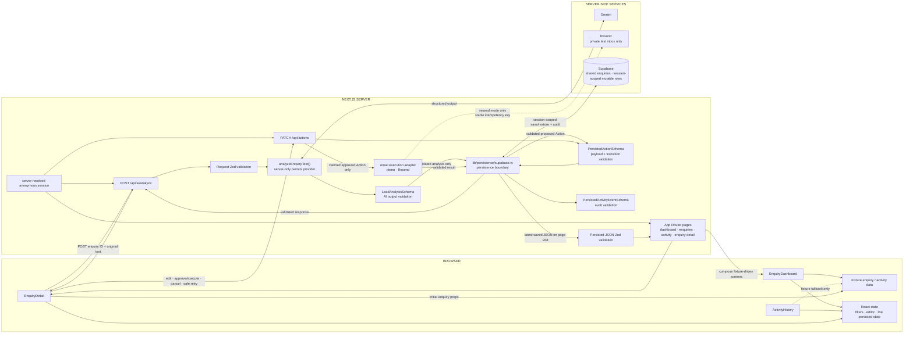
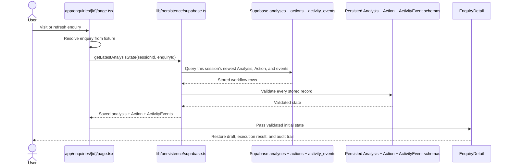
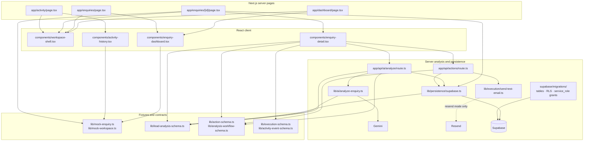

# Architecture map

## 1. Current system architecture



- The dashboard queue and source enquiries remain fixture-driven. Detail and `/activity` show validated persisted events when available and label the fixture fallback.
- A validated analysis and one proposed `draft_reply` Action are persisted by the intentional analysis workflow. Rerunning analysis creates a new Analysis and its own Action; page loads never create records.
- Edit and cancel persist with audit events. Approval atomically claims execution. `demo` records `email_simulated` without an external call; `resend` sends only to `TEST_EMAIL_RECIPIENT` and records the provider result.
- A server-issued HttpOnly UUID cookie scopes Analyses, Actions, and ActivityEvents. It isolates anonymous visitors but is not authentication.
- Gemini, Supabase, and Resend are server-only. The browser receives no provider credentials, configured test recipient, or client-submitted session identifier.

## 2. “Analyse with AI” execution sequence

```mermaid
sequenceDiagram
  actor User
  participant UI as Browser: EnquiryDetail
  participant API as Next.js: POST /api/ai/analyze
  participant Request as Request Zod validation
  participant Provider as Server: analyzeEnquiryText()
  participant Gemini as Gemini provider
  participant Output as LeadAnalysisSchema
  participant DB as Supabase persistence

  User->>UI: Click “Analyse with AI”
  UI->>UI: Validate request and POST enquiry ID + text
  UI->>API: POST JSON
  API->>Request: Validate request and match fixture
  Request-->>API: Validated request
  API->>Provider: analyzeEnquiryText(originalText)
  Provider->>Gemini: Request structured output
  Gemini-->>Provider: Structured JSON
  Provider->>Output: Parse and validate AI output
  Output-->>Provider: Validated LeadAnalysis
  Provider-->>API: Validated analysis
  API->>Output: Validate response wrapper
  API->>DB: Persist analysis + proposed Action
  DB-->>API: Save succeeds with Action
  API-->>UI: Validated analysis + Action response
  UI->>UI: Validate response; set persisted state
  UI-->>User: Render saved result and review controls
```

Persistence occurs only after Gemini output passes `LeadAnalysisSchema` validation. The proposed Action is application-owned data built from the fixture reply and validated analysis key points; it is not arbitrary provider output.

## 3. Human review and execution sequence

```mermaid
sequenceDiagram
  actor User
  participant UI as Browser: EnquiryDetail
  participant API as Next.js: PATCH /api/actions
  participant Zod as Action schemas + transition rules
  participant DB as Supabase actions
  participant Email as Execution mode adapter
  participant Resend as Resend

  User->>UI: Save edit, approve, cancel, or retry confirmed failure
  UI->>API: Validated Action ID, enquiry ID, operation, payload
  API->>Zod: Validate request and current persisted Action
  Zod->>DB: Atomically claim approved Action + write approval event
  alt Claim won
    DB-->>API: Approved pending Action
    API->>Email: Execute approved draft
    alt demo mode
      Email-->>API: Simulated success; no external call
    else resend mode
      Email->>Resend: TEST_EMAIL_RECIPIENT + stable Action idempotency key
      Resend-->>Email: Provider result
    end
    Email->>DB: Atomically save result + audit event
  else Duplicate or terminal request
    DB-->>API: Existing persisted result; do not send
  end
  API-->>UI: Validated Action + ActivityEvents
```

## 4. Page refresh / restore sequence



The server restores only the current anonymous session's review, execution, and audit state; refresh never triggers execution.

## 5. File dependency map



- `lib/mock-workspace.ts` remains the queue source and the explicit activity fallback before saved events exist.
- Execution and ActivityEvent schemas validate provider results, restored rows, and API contracts.
- The Stage 2E migration adds legacy-safe session columns, composite indexes, execution-mode state, truthful simulation events, and session-owned atomic RPCs callable only by `service_role`.

## Read these files in this order

1. [proxy.ts](./proxy.ts) and [lib/demo-session-server.ts](./lib/demo-session-server.ts) — see server-issued cookie isolation and server-only session resolution.
2. [app/enquiries/[id]/page.tsx](./app/enquiries/[id]/page.tsx) — see session-scoped restoration of the latest Analysis and associated Action.
3. [lib/persistence/supabase.ts](./lib/persistence/supabase.ts) — follow session filters, atomic claim/finalization, and validated restore boundaries.
4. [components/enquiry-detail.tsx](./components/enquiry-detail.tsx) — follow restored props and persisted review interactions.
5. [app/api/ai/analyze/route.ts](./app/api/ai/analyze/route.ts) — trace request validation, validated persistence, and response.
6. [lib/ai/analyze-enquiry.ts](./lib/ai/analyze-enquiry.ts) — inspect the server-only Gemini structured-output call.
7. [lib/action-schema.ts](./lib/action-schema.ts), [lib/execution-schema.ts](./lib/execution-schema.ts), and [lib/activity-event-schema.ts](./lib/activity-event-schema.ts) — review execution and audit contracts.
8. [supabase/migrations/20261008190000_demo_sessions.sql](./supabase/migrations/20261008190000_demo_sessions.sql) — inspect visitor scoping, execution-mode constraints, and session-owned atomic functions.
9. [lib/mock-workspace.ts](./lib/mock-workspace.ts), [components/enquiry-dashboard.tsx](./components/enquiry-dashboard.tsx), and [components/activity-history.tsx](./components/activity-history.tsx) — compare the fixture queue with the saved-audit activity path and labeled fallback.

## Current and future

**Current:** shared fixture enquiry → anonymous demo session → Gemini → validated session-owned Analysis → proposed Action → human approval → atomic claim → demo simulation or private Resend delivery → truthful ActivityEvent → session-scoped restore.

**Future:** retention cleanup, real customer delivery, CRM tools, authentication, background reconciliation, and other integrations. They are not part of this controlled portfolio execution path.
