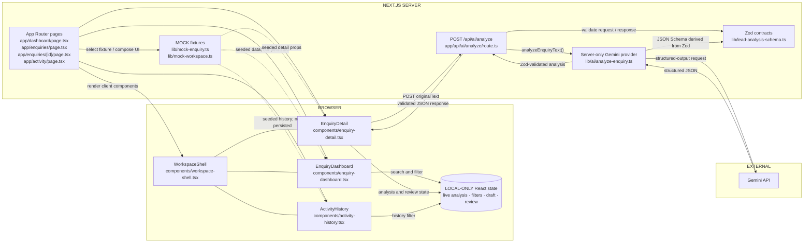
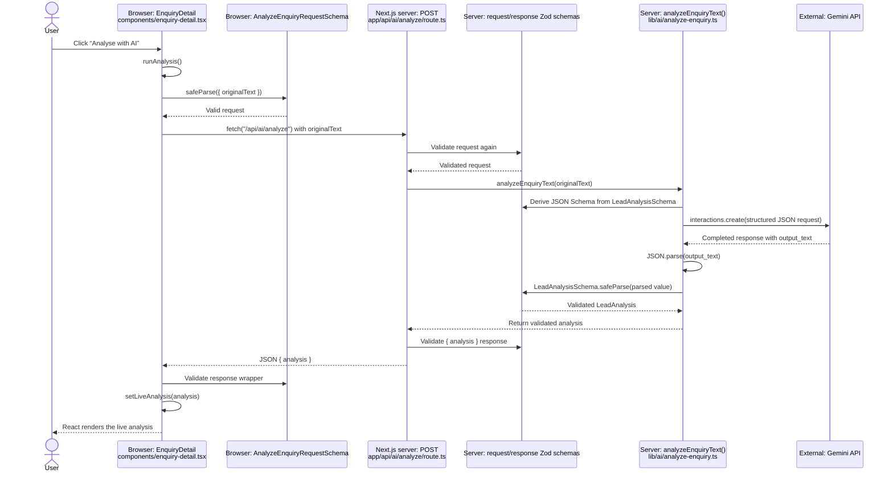
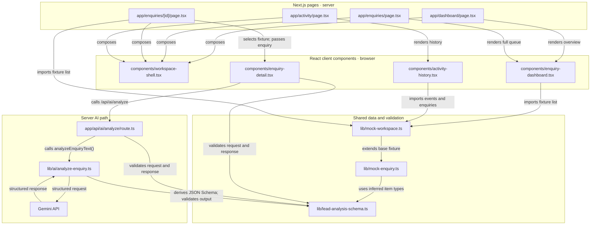

# Architecture map

## 1. Current system architecture

- The browser calls our API route; the browser never calls Gemini directly.
- Fixture records seed the queue, detail page, and activity feed; they are not database records.
- Live analysis and review interactions stay in React state, so refresh loses those changes.

## 2. “Analyse with AI” execution sequence

- Request text is validated in the browser and revalidated at the server boundary.
- Gemini’s structured output is parsed and then revalidated with `LeadAnalysisSchema`.
- The client validates the API response before storing it in `liveAnalysis`; that state is temporary.
- The provider retries only selected transient HTTP errors; auth, request, and schema failures do not retry.

## 3. File dependency / code map

- `WorkspaceShell` is shared navigation/layout; the pages compose it with the screen-specific client component.
- Queue, detail, and activity screens read typed fixtures; activity events are a separate seeded feed.
- `LeadAnalysisSchema` supplies both the inferred TypeScript type and runtime validation contract.

## Read these files in this order

1. [app/enquiries/[id]/page.tsx](./app/enquiries/[id]/page.tsx) — see how the server selects a fixture and passes it to the detail component.
2. [lib/mock-workspace.ts](./lib/mock-workspace.ts) — inspect the queue records and separate activity fixtures.
3. [components/enquiry-detail.tsx](./components/enquiry-detail.tsx) — follow `runAnalysis()`, local state, and the rendered result.
4. [app/api/ai/analyze/route.ts](./app/api/ai/analyze/route.ts) — trace request validation and the stable JSON response.
5. [lib/ai/analyze-enquiry.ts](./lib/ai/analyze-enquiry.ts) — inspect the server-only Gemini request, structured output, retries, and Zod revalidation.
6. [lib/lead-analysis-schema.ts](./lib/lead-analysis-schema.ts) — understand the shared runtime contract used at each boundary.
7. [components/enquiry-dashboard.tsx](./components/enquiry-dashboard.tsx) and [components/activity-history.tsx](./components/activity-history.tsx) — compare the fixture-driven queue and history views.
8. [components/workspace-shell.tsx](./components/workspace-shell.tsx) — see how route content is wrapped with shared navigation.

> The current source includes Gemini analysis; the Stage 1 status paragraph in `PROJECT_SPEC.md` predates that implementation. This map documents current code, not planned persistence or action execution.
