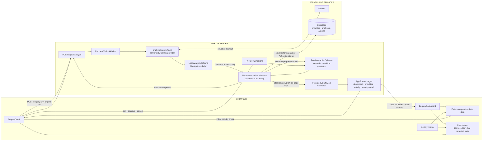
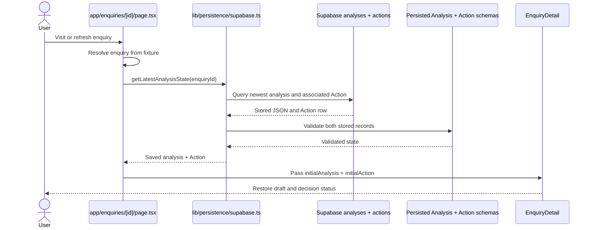
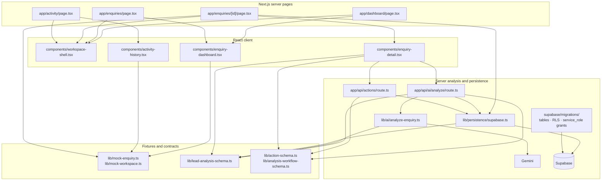

# Architecture map

## 1. Current system architecture



- The dashboard queue and workspace activity feed remain fixture-driven; fixture enquiries also provide the detail page's source enquiry.
- A validated analysis and one proposed `draft_reply` Action are persisted by the intentional analysis workflow. Rerunning analysis creates a new Analysis and its own Action; page loads never create records.
- Edit, approve, and cancel requests are validated by the Next.js server and persist the Action payload/status. Approval has no external side effect.
- Gemini and Supabase are called from server-side code. The browser receives neither the Gemini API key nor the Supabase secret key.

## 2. “Analyse with AI” execution sequence

```mermaid
sequenceDiagram
  actor User
  participant UI as Browser: EnquiryDetail
  participant API as Next.js: POST /api/ai/analyze
  participant Request as Request Zod validation
  participant Provider as Server: analyzeEnquiryText()
  participant Gemini as Gemini provider
  participant Output as LeadAnalysisSchema
  participant DB as Supabase persistence

  User->>UI: Click “Analyse with AI”
  UI->>UI: Validate request and POST enquiry ID + text
  UI->>API: POST JSON
  API->>Request: Validate request and match fixture
  Request-->>API: Validated request
  API->>Provider: analyzeEnquiryText(originalText)
  Provider->>Gemini: Request structured output
  Gemini-->>Provider: Structured JSON
  Provider->>Output: Parse and validate AI output
  Output-->>Provider: Validated LeadAnalysis
  Provider-->>API: Validated analysis
  API->>Output: Validate response wrapper
  API->>DB: Persist analysis + proposed Action
  DB-->>API: Save succeeds with Action
  API-->>UI: Validated analysis + Action response
  UI->>UI: Validate response; set persisted state
  UI-->>User: Render saved result and review controls
```

Persistence occurs only after Gemini output passes `LeadAnalysisSchema` validation. The proposed Action is application-owned data built from the fixture reply and validated analysis key points; it is not arbitrary provider output.

## 3. Human review sequence

```mermaid
sequenceDiagram
  actor User
  participant UI as Browser: EnquiryDetail
  participant API as Next.js: PATCH /api/actions
  participant Zod as Action schemas + transition rules
  participant DB as Supabase actions

  User->>UI: Save edit, approve, or cancel
  UI->>API: Validated Action ID, enquiry ID, operation, payload
  API->>Zod: Validate request and current persisted Action
  Zod->>DB: proposed/edited → edited/approved/cancelled
  DB-->>UI: Validated persisted Action
  Note over API,DB: Approval only stores the decision; no email executes
```

## 4. Page refresh / restore sequence



The server loads the latest persisted Analysis and its associated Action on each visit. Edited content and approval/cancellation status therefore do not depend on prior React state.

## 5. File dependency map



- `lib/mock-workspace.ts` remains the source for fixture-driven queue and activity data.
- `lib/lead-analysis-schema.ts` validates provider output and Analysis JSON; `lib/action-schema.ts` strictly validates persisted Actions, editable payloads, and allowed review transitions.
- The migrations create `enquiries`, `analyses`, and `actions`, keep RLS enabled, revoke browser-role access to Actions, and grant only the server role the required privileges.

## Read these files in this order

1. [app/enquiries/[id]/page.tsx](./app/enquiries/[id]/page.tsx) — see server-side restoration of the latest Analysis and associated Action.
2. [lib/persistence/supabase.ts](./lib/persistence/supabase.ts) — follow save, restore, and guarded Action update boundaries.
3. [components/enquiry-detail.tsx](./components/enquiry-detail.tsx) — follow restored props and persisted review interactions.
4. [app/api/ai/analyze/route.ts](./app/api/ai/analyze/route.ts) — trace request validation, validated persistence, and response.
5. [lib/ai/analyze-enquiry.ts](./lib/ai/analyze-enquiry.ts) — inspect the server-only Gemini structured-output call.
6. [lib/lead-analysis-schema.ts](./lib/lead-analysis-schema.ts) and [lib/action-schema.ts](./lib/action-schema.ts) — review Analysis and Action contracts.
7. [supabase/migrations/20261008120000_actions.sql](./supabase/migrations/20261008120000_actions.sql) — inspect the Action table, RLS, and server-only grants.
8. [lib/mock-workspace.ts](./lib/mock-workspace.ts), [components/enquiry-dashboard.tsx](./components/enquiry-dashboard.tsx), and [components/activity-history.tsx](./components/activity-history.tsx) — compare the still fixture-driven list and activity screens.

## Current and future

**Current:** fixture enquiry → Gemini → Zod validation → persisted Analysis + proposed Action → human edit/approve/cancel → persisted decision → server-loaded, validated state restored in the UI.

**Future:** execute an already approved Action through email/external API and persist `ActivityEvent` audit records. Approval currently stores a decision only; it never sends email.
