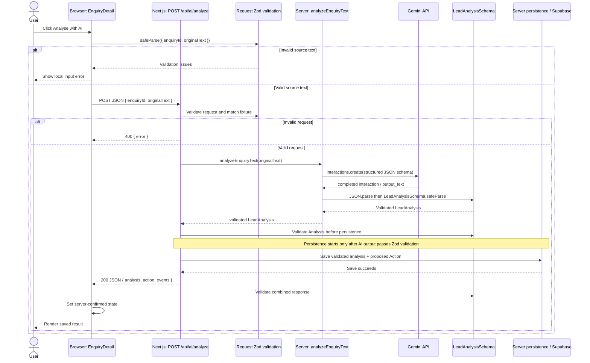

# Architecture walkthrough

This guide describes Stage 2E as implemented now: public visitors receive isolated anonymous workflow state, while approved `draft_reply` Actions execute through either a no-delivery demo adapter or the existing private Resend test path.

## Stage 2E public-safety boundary

`proxy.ts` issues a random UUID in an HttpOnly, same-origin cookie (`SameSite=Lax`, `Secure` in production). Server Components and Route Handlers resolve that cookie; API bodies never accept a session ID. The persistence boundary includes `demo_session_id` in every mutable Analysis, Action, and ActivityEvent query or write, and the action RPCs require the same session before editing, approving, cancelling, executing, or retrying. Shared fixture Enquiries remain reusable source records. This mechanism isolates anonymous portfolio visitors; it is deliberately not identity, authorization, or authentication.

`EMAIL_EXECUTION_MODE` accepts only `demo` or `resend`. Missing and invalid values resolve to `demo`, so deployment omission cannot enable delivery.

- **PUBLIC:** human approval → atomic claim → demo adapter → successful result → `email_simulated` → no Resend call.
- **PRIVATE TEST:** human approval → atomic claim → Resend adapter → test inbox → `email_sent` or safe failure state.

Both paths use the same Action state machine and database finalization RPC. Successful simulation has `execution_mode=demo`, no provider message ID, and the visible result `Email simulated successfully`. Resend retains its stable Action idempotency key, confirmed-failure retry, and indeterminate-outcome lock.

Existing development rows are retained with no demo session and are therefore invisible to anonymous public sessions. Automated retention is intentionally deferred for low-volume portfolio traffic.

## 1. Big picture

The current application combines fixture-driven workspace screens with a persisted AI analysis flow:

1. **Fixture enquiry data** still seeds queue rows and source fields. Fixture activity is explicitly labeled and used only until saved audit events exist.
2. **AI analysis and proposal** run through `POST /api/ai/analyze`. Validated output is saved as an Analysis, then the application creates one validated `draft_reply` Action linked to it.
3. **Human review and execution** run through `PATCH /api/actions`. Approval atomically claims execution; only the winning request reaches the configured demo or Resend adapter.
4. **Audit and restore** persist truthful execution results and ActivityEvents, then restore only the current demo session on refresh.

React state holds only the open editor and current server-confirmed values. Supabase is durable for Analysis, Action review/execution state, and ActivityEvents.

```mermaid
flowchart LR
  Browser["Browser"]
  Routes["Next.js App Router pages<br/>app/**/page.tsx"]
  Fixtures["Typed mock fixtures<br/>lib/mock-enquiry.ts<br/>lib/mock-workspace.ts"]
  Client["React client components<br/>detail / dashboard / activity / shell"]
  State["React state<br/>filters · editor · server-confirmed state"]
  API["Next.js API routes<br/>POST /api/ai/analyze<br/>PATCH /api/actions"]
  RequestSchema["Request Zod validation"]
  Provider["Server-only Gemini provider<br/>lib/ai/analyze-enquiry.ts"]
  AnalysisSchema["LeadAnalysisSchema<br/>AI and persisted JSON"]
  Gemini["Gemini API"]
  Persistence["Server-only persistence boundary<br/>lib/persistence/supabase.ts"]
  ActionSchema["PersistedActionSchema<br/>payload + transitions"]
  Email["Server-only execution mode<br/>demo or private Resend"]
  ActivitySchema["PersistedActivityEventSchema"]
  Supabase[("Supabase<br/>enquiries · analyses · actions · activity_events")]
  Resend["Resend"]

  Browser --> Routes
  Routes --> Fixtures
  Routes --> Client
  Fixtures --> Client
  Client --> State
  Client -- "enquiry ID + original text" --> API
  API --> RequestSchema
  API --> Provider
  Provider --> Gemini
  Provider --> AnalysisSchema
  Gemini -- "structured JSON text" --> Provider
  AnalysisSchema -->|"validated output only"| Persistence
  Persistence -->|"save workflow, execution result, audit"| Supabase
  Routes -->|"load newest state + audit"| Persistence
  Persistence -->|"validate persisted JSON"| AnalysisSchema
  Persistence --> ActionSchema
  Persistence --> ActivitySchema
  API -->|"approved claim only"| Email
  Email -.->|"resend mode only<br/>stable idempotency key"| Resend
  API -->|"after save: validated state"| Client
  Client --> State
  State --> Browser
```



The dashboard queue remains fixture-driven. Detail and activity pages use validated saved ActivityEvents when present and clearly label the fixture fallback.

The browser communicates only with Next.js. Gemini, Supabase, and Resend credentials plus `TEST_EMAIL_RECIPIENT` stay server-side. Logs omit enquiry and reply contents.

## 2. Exact “Analyse with AI” execution chain

The implemented path is:

```text
User clicks “Analyse with AI”
↓
EnquiryDetail validates { enquiryId, originalText } and POSTs to /api/ai/analyze
↓
Next.js route validates the request and matches ID + source text to a fixture
↓
analyzeEnquiryText(originalText) sends a structured-output request to Gemini
↓
Provider parses Gemini output and validates it with LeadAnalysisSchema
↓
Route validates the Analysis and constructs a validated Action
↓
lib/persistence/supabase.ts inserts the validated Analysis and one proposed Action
↓
Route returns validated { analysis, action, events }
↓
EnquiryDetail validates the response and renders persisted review controls
```

### Step-by-step with execution location and data

1. **Click — browser.** The analyze button in `EnquiryDetail` calls `runAnalysis()`. The component has the current enquiry as its `enquiry` prop; the detail route obtained that object from the mock fixture list.
2. **Validate the request — browser.** `runAnalysis()` calls `AnalyzeEnquiryRequestSchema.safeParse({ enquiryId: enquiry.id, originalText: enquiry.originalText })`. This checks the fixture ID and catches empty or overlong text before sending a request.
3. **Send source text — browser to server.** The client posts JSON containing `enquiryId` and `originalText`; contact details are not sent separately.
4. **Validate at the boundary — server.** `POST()` parses and validates the body, then requires the ID and original text to match a current fixture enquiry. Browser validation is only a UX aid.
5. **Call the provider — server.** The route invokes `analyzeEnquiryText()` with the trusted fixture text. The provider reads `GEMINI_API_KEY` and `GEMINI_MODEL` and calls Gemini's `interactions.create()`.
6. **Request and validate structured output — server.** Gemini receives a JSON response schema derived from `LeadAnalysisSchema`. The provider requires a completed interaction, parses `output_text`, and validates the unknown result with `LeadAnalysisSchema.safeParse()`.
7. **Validate the workflow response — server.** The route independently validates the Analysis before persistence, then validates `{ analysis, action, events }` before returning.
8. **Persist validated output and proposal — server.** `saveValidatedAnalysis()` revalidates, upserts the fixture Enquiry, inserts an Analysis, constructs an application-owned `draft_reply` from the existing fixture draft plus validated analysis key points, validates it, and inserts one linked proposed Action.
9. **Return and store the result — server to browser.** Only after workflow records and initial audit events save does the route return `{ analysis, action, events }`.
10. **Render — browser.** React displays the current validated analysis. When nullable identity values are absent, the component uses the fixture identity as a fallback.



Persistence errors use stable application errors. `PATCH /api/actions` saves edits/cancellation or atomically claims approval execution for the current session. Only the claimant executes: demo mode returns a simulated success without Resend; Resend mode uses `TEST_EMAIL_RECIPIENT` and `morrow-draft-reply/<action-id>` as the stable idempotency key. Success prevents all later execution. Confirmed provider failures may be retried explicitly; an unknown network outcome stays pending and locked for manual reconciliation.

## 3. Controlled approval execution chain

```text
validated approve request + server-resolved demo session
→ database atomically sets approved + pending + execution mode and writes approval event
→ winning request uses demo simulation or the test-only Resend path
→ application-owned simulated / delivered / failure / indeterminate result
→ database atomically stores result + ActivityEvent
→ validated state returned to UI and restored on refresh
```

Concurrent clicks and HTTP retries cannot both claim an Action. A duplicate request returns the existing stored state without calling Resend. Resend's matching idempotency key is a second barrier if the same claimed request reaches the provider again.

## 4. Important files, one by one

### `app/layout.tsx`

**Purpose:** Root App Router layout. Imports global CSS and defines page metadata and the outer HTML document.

**Called by:** Next.js for routes under `app/`.

**Calls / depends on:** `app/globals.css`; Next.js `Metadata` and `LayoutProps` types.

**Important exports/functions/components:** `metadata`; `RootLayout`.

**Data in:** `children`, supplied by the active route tree.

**Data out:** `<html lang="en"><body>…</body></html>` around the route.

**Runs where:** Next.js server rendering.

**Why it exists:** The root layout is the shared document shell; individual pages provide route content.

### `app/page.tsx`

**Purpose:** Implements `/` as a redirect to `/dashboard`.

**Called by:** A request or navigation to `/`.

**Calls / depends on:** `redirect` from `next/navigation`.

**Important exports/functions/components:** `Home`.

**Data in:** No application data.

**Data out:** A redirect response to `/dashboard`.

**Runs where:** Next.js server.

**Why it exists:** Keeps `/dashboard` as the application's default workspace view.

### `app/dashboard/page.tsx`

**Purpose:** Route page for the Overview triage queue.

**Called by:** A request/navigation to `/dashboard`.

**Calls / depends on:** `WorkspaceShell` and `EnquiryDashboard`.

**Important exports/functions/components:** `DashboardPage`.

**Data in:** No fetched data; the dashboard component reads mock fixtures.

**Data out:** The shared shell containing `EnquiryDashboard` with `view="overview"`.

**Runs where:** Page composition runs as a Next.js Server Component; the imported interactive components run client-side.

**Why it exists:** Separates route composition from reusable queue rendering.

### `app/enquiries/page.tsx`

**Purpose:** Route page for the full enquiries queue.

**Called by:** A request/navigation to `/enquiries`.

**Calls / depends on:** `WorkspaceShell` and `EnquiryDashboard`.

**Important exports/functions/components:** `EnquiriesPage`.

**Data in:** No fetched data; `EnquiryDashboard` reads fixtures.

**Data out:** The queue configured with `view="enquiries"` (initially showing all statuses).

**Runs where:** Server Component composition plus client-rendered interactive children.

**Why it exists:** Reuses the queue UI with a different initial view instead of duplicating the list.

### `app/enquiries/[id]/page.tsx`

**Purpose:** Resolves a detail URL to its fixture Enquiry and loads its newest saved Analysis plus associated Action.

**Called by:** A request/navigation to a dynamic enquiry detail URL.

**Calls / depends on:** `mockEnquiries`, `getLatestAnalysisState()` from `lib/persistence/supabase.ts`, `WorkspaceShell`, `EnquiryDetail`, and Next.js `notFound()`.

**Important exports/functions/components:** `EnquiryPage()` uses `connection()` so each visit loads and validates the latest Analysis and its Action rather than freezing database state at build time.

**Data in:** The dynamic `id` route parameter.

**Data out:** `EnquiryDetail` receives `initialAnalysis`, `initialAction`, the fixture Enquiry, and an optional safe persistence warning.

**Runs where:** Next.js server. `generateStaticParams()` supplies known fixture IDs, while `connection()` keeps the per-visit persistence query out of build-time rendering.

**Why it exists:** Keeps fixture lookup and database access server-side, then gives the interactive detail component both the stable source enquiry and the validated saved result.

### `app/activity/page.tsx`

**Purpose:** Route page for workspace activity history.

**Called by:** A request/navigation to `/activity`.

**Calls / depends on:** `WorkspaceShell` and `ActivityHistory`.

**Important exports/functions/components:** `ActivityPage`.

**Data in:** No fetched data; the activity component reads seeded events.

**Data out:** The shared shell containing the client-side activity feed.

**Runs where:** Server Component composition plus client component behavior.

**Why it exists:** Keeps route composition separate from the filterable history UI.

### `components/workspace-shell.tsx`

**Purpose:** Shared navigation and visual shell around route content.

**Called by:** The dashboard, enquiries, activity, and enquiry detail route pages.

**Calls / depends on:** Next.js `usePathname()` and `Link`; React `useState`; Lucide icons.

**Important exports/functions/components:** `WorkspaceShell` reads the current path to select active navigation/breadcrumbs and owns `mobileNavOpen` for the responsive menu.

**Data in:** `children` as `ReactNode`, usually page content composed by a Server Component.

**Data out:** Sidebar, top bar, mobile navigation, and a main region containing those children.

**Runs where:** Browser, because the module starts with `"use client"` and uses pathname and React state.

**Why it exists:** Centralizes workspace navigation/layout while letting route pages provide their own content.

### `components/enquiry-dashboard.tsx`

**Purpose:** Renders both the Overview attention queue and the full Enquiries list.

**Called by:** `app/dashboard/page.tsx` and `app/enquiries/page.tsx`.

**Calls / depends on:** `mockEnquiries`; Next.js `Link`; local React state; icons.

**Important exports/functions/components:** `EnquiryDashboard({ view })`; `QueueFilter`; `formatReceivedAt()`.

**Data in:** Optional `view` prop (`"overview"` or `"enquiries"`), and mock records from `mockEnquiries`.

**Data out:** Filtered display rows that link to `/enquiries/[id]`; it does not fetch or mutate records.

**Runs where:** Browser (`"use client"`), because search input and filter selection are interactive.

**Why it exists:** One client component serves two queue routes. `view` selects the initial status filter; search and selected filter are local state. “Attention” means all workflow statuses except `"responded"`.

### `components/enquiry-detail.tsx`

**Purpose:** Main enquiry review screen: identity, Analysis, source message, and persisted Action review.

**Called by:** `app/enquiries/[id]/page.tsx`, which passes a fixture as `enquiry`.

**Calls / depends on:** Analysis and Action schemas; same-origin `/api/ai/analyze` and `/api/actions`; `initialAnalysis`, `initialAction`, and fixture props.

**Important exports/functions/components:** `runAnalysis()` accepts only validated saved Analysis+Action+event responses. `updateAction()` saves edits/cancellation or requests controlled approval execution, then updates from validated server state.

**Data in:** A fixture Enquiry plus optional Zod-validated persisted Analysis and Action.

**Data out:** Review UI whose draft, execution result, and timeline come from persisted state once a real workflow exists; otherwise the timeline says `FIXTURE HISTORY`.

**Runs where:** Browser (`"use client"`), because it owns button events, request loading/errors, editing, and local review interactions.

**Why it exists:** It keeps interactive editing in the browser while delegating all database access, validation, and transitions to the server.

### `components/activity-history.tsx`

**Purpose:** Renders the workspace-wide seeded activity feed.

**Called by:** `app/activity/page.tsx`.

**Calls / depends on:** Server-provided persisted ActivityEvents, mock fallback events, local filters, and enquiry links.

**Important exports/functions/components:** `ActivityHistory`; `matchesFilter()` defines event categories; `eventPresentation` maps event types to icons/styles; `formatDate()` and `formatTime()` produce labels.

**Data in:** Zod-validated persisted events when available, otherwise clearly labeled fixture events.

**Data out:** Events filtered by type, sorted newest-first, grouped by date, and linked to matching enquiry details where possible.

**Runs where:** Browser (`"use client"`), as the activity filter is interactive.

**Why it exists:** Makes the persisted audit trail visible without adding another product surface.

### `app/api/ai/analyze/route.ts`

**Purpose:** Server-side HTTP boundary for analysis requests.

**Called by:** The browser's `fetch("/api/ai/analyze")` from `EnquiryDetail.runAnalysis()`.

**Calls / depends on:** Analysis/workflow schemas, `analyzeEnquiryText()`, `saveValidatedAnalysis()`, and typed safe errors.

**Important exports/functions/components:** `POST(request)` validates input, runs and validates analysis, persists the Analysis and proposed Action, and only then returns the combined response.

**Data in:** An HTTP JSON request containing `enquiryId` and `originalText`.

**Data out:** Success only after save: `{ analysis, action, events }`; failures retain stable safe 400/502/503 contracts.

### `app/api/actions/route.ts`

**Purpose:** Small server mutation boundary for Action review.

**Important behavior:** `PATCH()` validates the request and demo enquiry. Edit/cancel use an atomic review+event function. Approve/retry atomically claim execution; only a successful claim calls the email service. Duplicate or already-successful requests return stored state without sending.

**Runs where:** Next.js server route handler, not in the browser.

**Why it exists:** It prevents the browser from needing provider or database credentials, validates untrusted incoming requests, orders persistence after output validation, and keeps provider/database errors behind a stable application response contract.

### `lib/ai/analyze-enquiry.ts`

**Purpose:** Implements the Gemini provider boundary for one enquiry analysis.

**Called by:** `POST()` in `app/api/ai/analyze/route.ts`.

**Calls / depends on:** `@google/genai` (`GoogleGenAI`, `ApiError`); Zod's `toJSONSchema()`; `LeadAnalysisSchema` and `LeadAnalysis`.

**Important exports/functions/components:** `analyzeEnquiryText(originalText)` reads server environment variables, submits the request, checks/parses output, and returns validated analysis. `AnalysisConfigurationError` signals missing key/model; `AnalysisOutputError` signals unavailable, malformed, or schema-invalid output.

**Data in:** `originalText` from the validated API request; `GEMINI_API_KEY` and `GEMINI_MODEL` from the server environment.

**Data out:** A `LeadAnalysis` value only after successful Zod validation.

**Runs where:** Next.js server only. The module imports `"server-only"` and must not be imported into client components.

**Why it exists:** Keeps provider SDK calls and the secret key out of the UI and route implementation. It also owns structured-output configuration and provider retry policy.

**Current provider behavior:** The model is read from `GEMINI_MODEL`; `.env.example` sets the development example to `gemini-3.5-flash-lite`. The provider does not silently substitute a model if this environment variable is missing. Thinking is set to `"minimal"`. The request has a 30-second SDK timeout and SDK retries are disabled. The provider retries only `ApiError` HTTP statuses 429, 500, 502, 503, and 504, up to two retries after the first attempt, waiting 500 ms and then 1,000 ms. Authentication, bad-request, schema, and non-HTTP errors are not retried. Development logs include only model, attempt, and elapsed milliseconds.

### `lib/persistence/supabase.ts`

**Purpose:** Owns the server-only Supabase boundary for workflow creation, atomic execution claims/finalization, ActivityEvent persistence, and validated restoration.

**Called by:** Both API routes and the server detail page.

**Calls / depends on:** Supabase, server-only credentials, Analysis/Action/ActivityEvent schemas, and execution-result contracts.

**Important exports/functions/components:** `saveValidatedAnalysis()` saves Analysis, proposed Action, and initial audit events. `claimPersistedActionExecution()` uses the database claim function. `finalizePersistedActionExecution()` atomically stores provider result plus audit event. Read functions validate every restored row.

**Runs where:** Next.js server only. The module imports `"server-only"`; its privileged credential and client are never sent to the browser.

**Why it exists:** Centralizes database access and validation of saved JSON. Database diagnostics are logged without enquiry data or credentials; the API returns safe error messages.

### Supabase migrations

The original migrations create `enquiries`, `analyses`, and `actions`. `20261008170000_activity_execution.sql` adds controlled execution and audit state. `20261008190000_demo_sessions.sql` adds visitor scope, execution mode, `email_simulated`, composite indexes, and session-enforcing review/claim/finalization functions without deleting legacy rows.

The browser never queries these tables. The service role is used only inside the `server-only` persistence module.

### Execution and audit schemas

`PersistedActionSchema` validates review and execution invariants. `EmailExecutionResultSchema` permits only succeeded, confirmed failed, or indeterminate outcomes. `PersistedActivityEventSchema` validates IDs, relationships, event type, safe structured details, and timestamps. API responses include validated events.

### `lib/execution/send-test-email.ts`

This server-only Resend boundary is reached only in `resend` mode and accepts an approved, claimed, pending Action. It redirects delivery to validated `TEST_EMAIL_RECIPIENT`, prepends `[Morrow Test]`, uses plain text, and sends with the stable Action-derived idempotency key. Demo execution is resolved before this boundary and cannot instantiate or call Resend.

### `lib/lead-analysis-schema.ts`

**Purpose:** Defines the application validation contract shared by the browser and server.

**Called by:** API route, provider, enquiry detail component, persistence module, and schema/persistence tests.

**Calls / depends on:** Zod.

**Important exports/functions/components:** `LeadAnalysisSchema` defines company/contact/project fields; nullable budget and timeline facts; bounded priority and score; requirements; missing information; qualification summary; and recommended next step. The nested analysis objects and outer analysis schema are strict. `parsePersistedAnalysis()` applies that same contract to untrusted stored JSON. Request and safe error schemas cover the HTTP boundary. `LeadAnalysis` is inferred from the runtime schema.

**Data in:** Unknown JavaScript values from Gemini, HTTP payloads, and persisted JSON.

**Data out:** Parse results (success with typed data or failure with issues); the inferred `LeadAnalysis` TypeScript type.

**Runs where:** Both browser and server. The client validates request/response/error payloads; the server validates requests and AI results, and the persistence module validates both before save and after restore.

**Why it exists:** One runtime schema and inferred type keep validation and TypeScript shapes aligned. The provider also derives Gemini's JSON Schema from this source of truth.

### `lib/mock-enquiry.ts`

**Purpose:** Defines the base `MockEnquiry` shape, reusable fixture item types, and one complete sample enquiry.

**Called by:** `lib/mock-workspace.ts` uses the sample as a base; detail-related types consume its declared interfaces.

**Calls / depends on:** `LeadAnalysis` types for requirement and missing-information item shapes.

**Important exports/functions/components:** `Requirement`, `MissingInformation`, `ActivityEvent`, `MockEnquiry`, and `mockEnquiry`.

**Data in:** No runtime external data.

**Data out:** A representative fixture including original text, prefilled analysis-like display fields, a draft reply, and per-enquiry activity.

**Runs where:** Imported in both server page composition and client components; it is static module data.

**Why it exists:** Gives the mock UI a typed example and keeps fixture definitions separate from rendering.

### `lib/mock-workspace.ts`

**Purpose:** Defines workflow-oriented types and the queue/activity fixtures for the workspace.

**Called by:** Dashboard, activity history, and dynamic detail route.

**Calls / depends on:** Spreads and extends `mockEnquiry`.

**Important exports/functions/components:** `WorkspaceEnquiry` extends `MockEnquiry` with source, summary, workflow/analysis statuses, optional action state/outcome, and an ISO timestamp. `mockEnquiries` is the detail/queue record set. `WorkspaceActivityEvent` and `mockWorkspaceActivity` provide the separate workspace history feed.

**Data in:** The base `mockEnquiry` object, overridden to create the other examples.

**Data out:** Typed arrays consumed as initial UI data.

**Runs where:** Server and client as imported by route files and client components.

**Why it exists:** Separates seeded queue/demo fallback data from persisted workflow records. Saved ActivityEvents replace these events in activity views when available.

### `tests/lead-analysis-schema.test.mjs`

**Purpose:** Focused Node tests for `LeadAnalysisSchema`.

**Called by:** `yarn test:analysis`.

**Calls / depends on:** Imports the schema from `lib/lead-analysis-schema.ts` and uses Node's test/assert APIs.

**Important exports/functions/components:** Tests complete analysis acceptance, nullable source data, arbitrary/null project types, score bounds, and allowed priority values.

**Data in:** Example JavaScript analysis objects.

**Data out:** Pass/fail results. This test file does not call the Gemini API or test the API route/retry flow.

**Runs where:** Node test process, outside the browser.

**Why it exists:** Verifies the core runtime model independently of UI and provider availability.

### `tests/persisted-analysis.test.mjs`

**Purpose:** Focused Node tests for validating stored Analysis JSON.

**Called by:** `yarn test:persistence`.

**Calls / depends on:** `parsePersistedAnalysis()` from `lib/lead-analysis-schema.ts`; Node's test/assert APIs.

**What it verifies:** A valid analysis object can be restored, while malformed or schema-extended stored JSON is rejected. It does not connect to Supabase or test network persistence.

### `tests/action-schema.test.mjs`

**Purpose:** Verifies valid persisted Action parsing, rejection of unsupported types/statuses and malformed payloads, schema-valid edited content, allowed approval/cancellation transitions, and terminal-state protection. It is a pure application-logic test, not a live Supabase test.

### `tests/activity-execution-schema.test.mjs`

**Purpose:** Verifies ActivityEvent parsing, claim eligibility, terminal duplicate protection, test-recipient redirection, stable idempotency keys, and safe execution-result categories without contacting Resend.

### Verification status

Automated suites cover Analysis, Action execution invariants, truthful simulated events, both execution-mode branches, safe default configuration, anonymous-session ownership helpers, test-recipient redirection, stable idempotency keys, and failure representation. They do not call Gemini, Supabase, or Resend. Stage 2E still requires the documented two-browser live isolation test.

### `README.md`, `.env.example`, and `.gitignore`

**Purpose:** Document local Gemini, Supabase, and controlled Resend setup while keeping secrets out of source control.

**Called by:** Developers while configuring/running the app; `.gitignore` is applied by Git.

**Calls / depends on:** `.env.example` names Gemini/Supabase configuration plus `EMAIL_EXECUTION_MODE`, `RESEND_API_KEY`, and `TEST_EMAIL_RECIPIENT`; `.gitignore` keeps actual values out of source control.

**Important exports/functions/components:** None; these are setup files.

**Data in:** Developer-provided environment configuration.

**Data out:** A documented environment setup. Actual values are loaded from the local environment by Next.js and read by server code.

**Runs where:** Documentation/Git tooling; environment values are made available to Next.js server runtime.

**Why it exists:** Keeps setup instructions separate from runtime code and reduces the risk of committing `.env.local`. The Supabase secret key must remain server-only and must not use a `NEXT_PUBLIC_` prefix.

## 5. React state and what survives refresh

Keep these data/state categories separate:

1. **Fixture enquiry data** seeds queue rows and source/contact fields; fixture activity is only a labeled fallback.
2. **Persisted Analysis, Action, and ActivityEvents** are the durable AI result, proposal, review/execution result, and audit trail.
3. **Temporary React state** holds editor text/loading/errors and the latest server-confirmed records while mounted.
4. **Server-loaded persisted state** is queried and validated on each detail-page visit, then passed as `initialAnalysis`, `initialAction`, and `initialEvents`.

### `EnquiryDashboard`

- `filter` begins as `"attention"` on the overview and `"all"` on the full enquiries route. The `key` props in those route pages ensure the shared component gets distinct initial state when switching route identity.
- `query` stores the search input.
- `visibleEnquiries` is derived on each render by filtering `mockEnquiries` by status and searchable text.
- Both states are in the browser only. Refresh restores the route's initial filter and an empty search string.

### `ActivityHistory`

- `filter` begins as `"all"` and changes when the user selects an activity category.
- Sorted, filtered, grouped events derive from validated persisted events when available; otherwise the page labels and shows the fixture fallback.
- Refresh resets only the filter and reloads the saved audit trail from Supabase.

### `WorkspaceShell`

- `mobileNavOpen` controls only whether its responsive navigation is visible.
- Active navigation and breadcrumb values derive from `usePathname()`, not a separate saved state.
- A route transition or refresh does not persist an open-menu setting.

### `EnquiryDetail`

- Initial `enquiry` data comes from `mockEnquiries` selected in the server route.
- `action` starts from validated `initialAction`; `draftBody` is only the controlled editor value. Saving, approving, or cancelling must succeed through `/api/actions` before durable UI state changes.
- `liveAnalysis` starts from the server-provided `initialAnalysis` (or `null`). A successful `/api/ai/analyze` response replaces it after the server has persisted the validated result.
- `isAnalyzing` drives the loading UI; `analysisError` holds a message for the current request.
- The analysis fields shown are derived from the live object when present, otherwise from the fixture. Some nullable live values intentionally display as “Not identified” or “Not provided” rather than returning to a seeded analysis value.
- Approval claims the configured simulation or controlled test email, then persists mode plus succeeded/failed/pending state. Cancelled Actions never execute.
- `persistedEvents` replaces the fixture detail timeline after a real workflow is saved.

On refresh, filters reset. The server restores the current session's newest validated Analysis, associated Action execution result, and persisted audit trail; refresh itself never executes anything.

## 6. External-service boundaries and environment

The external-service paths are:

```text
Browser → Next.js server → Gemini
Enquiry detail page → Next.js server → Supabase
Approved claimed Action → Next.js server → demo success (public, no email)
Approved claimed Action → Next.js server → Resend → TEST_EMAIL_RECIPIENT (private test)
```

`EnquiryDetail` knows only same-origin routes. Database and email work remain in server-only modules. The browser never receives Gemini, Supabase, or Resend credentials or the configured test recipient.

The server reads Gemini and Supabase configuration plus `EMAIL_EXECUTION_MODE`. Missing or invalid mode configuration resolves to `demo`. Only explicit `resend` mode reads `RESEND_API_KEY` and `TEST_EMAIL_RECIPIENT`; missing/invalid Resend configuration creates a safe failed state without contacting the provider and does not roll back human approval.

RLS is enabled on all four tables. The new migration revokes `anon`/`authenticated` table and function access, grants `service_role` only `SELECT`/`INSERT` for activity plus required function execution, and grants no delete permission. Diagnostics omit enquiry contents, draft body, recipient, and credentials.

The provider retries known transient HTTP API errors only: 429 and selected 5xx statuses (500, 502, 503, 504). These commonly represent rate limiting or temporary service trouble. It makes at most three calls total (initial attempt plus two retries), with short increasing delays. Other failures such as authentication or malformed requests cannot be fixed by repeating the same request, so they fail immediately. Model output validation failures happen after the provider call and are not part of this retry loop.

In development, timing logs report model name, attempt number, and elapsed milliseconds. They do not log the key, enquiry, or model output. The API route has separate server-side provider diagnostics; browser-facing errors remain generic or schema-defined.

## 7. Zod and structured external data

`LeadAnalysisSchema` in `lib/lead-analysis-schema.ts` is the runtime source of truth for a valid analysis. It describes required fields and constraints such as nullable unknown facts, allowed priority values, numeric lead score between 0 and 100, and strict nested objects. `LeadAnalysis` is inferred from that schema, so TypeScript consumers use the same field structure that runtime validation enforces.

The provider converts the schema for Gemini and then still validates Gemini's answer:

```text
LeadAnalysisSchema (Zod)
↓ z.toJSONSchema(..., { target: "draft-7" })
JSON Schema passed as response_format.schema
↓
Gemini structured JSON output in output_text
↓ JSON.parse()
unknown JavaScript value
↓ LeadAnalysisSchema.safeParse()
validated LeadAnalysis
```

The exact Gemini request sets `response_format` to text with `mime_type: "application/json"` and supplies the JSON Schema. That asks the model to constrain output to the structured shape; it does not make external output inherently trustworthy. The response still crosses a network/provider boundary and can be absent, malformed, or violate application constraints. `JSON.parse()` checks JSON syntax; it does not check field types or business constraints. `safeParse()` performs that second check and produces a typed value only on success.

The route validates AI output independently, then validates `{ analysis, action, events }`. Action requests, Resend results, ActivityEvents, and every restored database row have strict application-owned schemas.

## 8. Next.js concepts used here

- **App Router:** The `app/` directory maps pages and the `/api/ai/analyze` plus `/api/actions` route handlers.
- **`page.tsx`:** Route UI entry points are in `app/**/page.tsx`. They are Server Components by default. Here they compose the shell and client components, rather than owning interactive state.
- **Dynamic route:** `app/enquiries/[id]/page.tsx` uses the `[id]` folder to capture an enquiry ID. It awaits Next.js's `params` promise, selects a matching mock record, and uses `notFound()` when no fixture matches. `generateStaticParams()` exposes the existing fixture IDs; `connection()` ensures the saved-analysis query runs at request time.
- **API `route.ts`:** Analysis uses `POST`; Action review uses uncached `PATCH`. Both are server boundaries called by the client component.
- **Client components:** `components/enquiry-detail.tsx`, `components/enquiry-dashboard.tsx`, `components/activity-history.tsx`, and `components/workspace-shell.tsx` start with `"use client"` because they use state, event handlers, browser fetch, or client navigation state.
- **Server/client composition:** Server pages load and validate workflow/audit state before passing serializable props to client components.
- **Server-only integrations:** Gemini, Supabase, and Resend modules import `"server-only"` and own their private credentials.
- **Root layout:** `app/layout.tsx` provides the shared document, global stylesheet import, and metadata. `app/page.tsx` uses Next's `redirect()` to send the root route to the dashboard.

## 9. Recommended reading order

1. **`app/enquiries/[id]/page.tsx`** — Follow request-time Analysis+Action restore.
2. **`lib/persistence/supabase.ts`** — Understand save, atomic execution claim/finalization, and restore paths.
3. **`components/enquiry-detail.tsx`** — Follow persisted review interactions.
4. **`app/api/ai/analyze/route.ts`** — Trace request validation, AI validation, persistence ordering, and response.
5. **`lib/ai/analyze-enquiry.ts`** — Read the server-only Gemini request, structured-output config, retries, and Zod validation.
6. **`lib/action-schema.ts`, `lib/execution-schema.ts`, and `lib/activity-event-schema.ts`** — Learn execution/audit contracts.
7. **`supabase/migrations/20261008170000_activity_execution.sql`** — Review idempotency claims, audit transactions, RLS, and grants.
8. **`lib/mock-workspace.ts`** and **`lib/mock-enquiry.ts`** — Compare fixture enquiry/activity data with persisted Analysis data.
9. **`components/activity-history.tsx`** — See persisted audit display and labeled fixture fallback.
10. **`components/workspace-shell.tsx`** — See shared navigation and its local state.
11. **`tests/*.test.mjs`** — Review pure Analysis and Action validation tests; none calls Gemini or Supabase.
12. **`app/dashboard/page.tsx`, `app/enquiries/page.tsx`, `app/activity/page.tsx`, `app/layout.tsx`, and `app/page.tsx`** — Review the remaining route composition and root layout/redirect.

## 10. Current architecture versus future work

### Current implementation

```text
fixture enquiry
       ↓
React client → POST /api/ai/analyze
       ↓
Next.js server → Gemini structured output
       ↓
Zod validation → persisted Analysis + proposed Action + audit events
↓
human edit / approve / cancel → validated PATCH
↓
atomic execution claim → controlled Resend test delivery
↓
persisted result + ActivityEvent
↓ later visit / refresh
server-side Supabase query → stored Analysis + Action + events Zod validation
↓
UI restores analysis, content, execution result, and audit trail
```

The queue and source enquiries remain fixture-based. Approved Actions send only to the configured developer test inbox; fictional customer addresses are never delivery targets.

### Future architecture

Future work is deliberately outside this controlled portfolio path:

```text
real customer delivery · CRM tools · authentication · background reconciliation · other integrations
```

The indeterminate network state intentionally requires manual reconciliation; it is not automatically retried because avoiding duplicate email is the stronger safety requirement.
