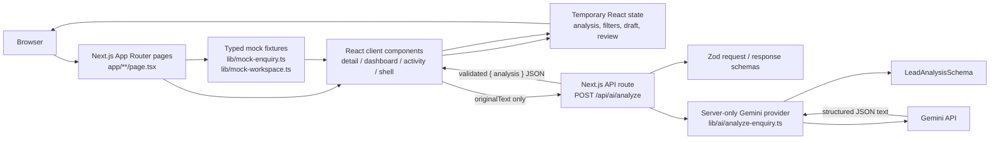
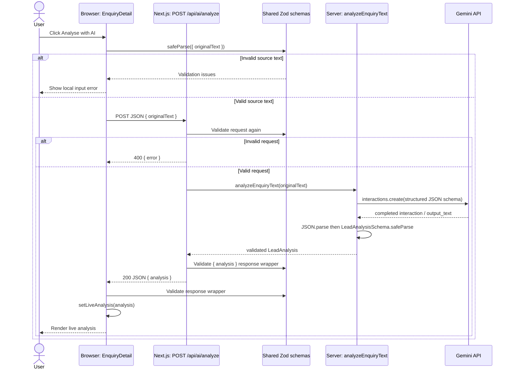

# Architecture walkthrough

This guide describes the code that is implemented in this repository now. It is not a claim that the complete future V1 workflow in [PROJECT_SPEC.md](PROJECT_SPEC.md) already exists.

Some status paragraphs in the spec describe the earlier Stage 1 prototype, before the Gemini increment. In the current code, the `POST /api/ai/analyze` → Gemini → Zod-validated temporary client result path is implemented; the other mock-only and non-persisted limitations described below remain.

## 1. Big picture

The app is a small Next.js App Router application with two kinds of state:

1. **Seeded workspace state** comes from TypeScript fixtures in `lib/mock-enquiry.ts` and `lib/mock-workspace.ts`. The queue, initial detail views, and workspace activity feed are based on these fixtures.
2. **One live capability** is implemented: a user can send an enquiry's original text from the detail page through the Next.js API route to Gemini. The server validates the structured response with Zod, and the client validates the API response before showing it.

Most of the interface is React client code because it has local interactions such as filtering, editing a draft, opening mobile navigation, and requesting AI analysis. The route `page.tsx` files are Next.js Server Components by default. They select fixture data and compose the client components.

There is no database or persistence layer. Live analysis, search/filter selections, draft edits, approval/cancellation presentation, and detail-page timeline changes live in React state. A refresh resets them to the fixture values. The activity page is a separately seeded fixture feed and does not become a durable record of actions performed on a detail page.



The provider and API route run on the server. The `GEMINI_API_KEY` is read only by server-side code; it is not passed as a prop or returned in an API response. The browser communicates with our API, not directly with Gemini.

## 2. Exact “Analyse with AI” execution chain

The implemented path is:

```text
Browser: user clicks “Analyse with AI”
↓
components/enquiry-detail.tsx: button invokes runAnalysis()
↓
Browser: AnalyzeEnquiryRequestSchema.safeParse({ originalText })
↓
Browser: fetch("/api/ai/analyze") with JSON { originalText }
↓
Next.js server: app/api/ai/analyze/route.ts, POST()
↓
Server: parse JSON and validate request again with AnalyzeEnquiryRequestSchema
↓
Server: analyzeEnquiryText(originalText)
↓
lib/ai/analyze-enquiry.ts: send structured-output request to Gemini
↓
Gemini returns an Interaction with output_text containing JSON
↓
Server: check completion, JSON.parse(), then LeadAnalysisSchema.safeParse()
↓
Server route: validate { analysis } using AnalyzeEnquiryResponseSchema
↓
Server: return JSON { analysis }
↓
Browser: parse response JSON, validate using AnalyzeEnquiryResponseSchema
↓
Browser: setLiveAnalysis(analysis)
↓
React rerenders the detail page using the live result where available
```

### Step-by-step with execution location and data

1. **Click — browser.** The analyze button in `EnquiryDetail` calls `runAnalysis()`. The component has the current enquiry as its `enquiry` prop; the detail route obtained that object from the mock fixture list.
2. **Validate the request — browser.** `runAnalysis()` calls `AnalyzeEnquiryRequestSchema.safeParse({ originalText: enquiry.originalText })`. This catches empty or overlong text before sending a request and gives the UI a local error if invalid.
3. **Send source text — browser to server.** The client posts JSON to `/api/ai/analyze`. The body contains only `originalText`; the fixture's contact details are not included in this request.
4. **Validate at the boundary — server.** `POST()` in `app/api/ai/analyze/route.ts` parses the JSON body and validates it again. Client validation is useful for UX, but is not trusted as a server-side security boundary.
5. **Call the provider — server.** The route invokes `analyzeEnquiryText(parsedRequest.data.originalText)`. `lib/ai/analyze-enquiry.ts` reads `GEMINI_API_KEY` and `GEMINI_MODEL`, builds a `GoogleGenAI` client, and calls its `interactions.create()` method.
6. **Request structured output — server to Gemini.** The request includes the analysis instructions, the enquiry text, `generation_config.thinking_level: "minimal"`, and a JSON response format whose schema was generated from `LeadAnalysisSchema`.
7. **Handle provider response — server.** The provider requires a completed interaction with non-empty `output_text`. It parses that text with `JSON.parse()` and validates the unknown parsed value with `LeadAnalysisSchema.safeParse()`. It returns only the Zod-validated data.
8. **Validate the API response — server.** The route wraps the analysis as `{ analysis }` and validates the wrapper with `AnalyzeEnquiryResponseSchema` before returning it.
9. **Validate and store locally — browser.** The client parses the response body as `unknown`. It validates API errors with `AnalyzeEnquiryErrorSchema`; on success it validates the response wrapper again and calls `setLiveAnalysis()`.
10. **Render — browser.** React rerenders `EnquiryDetail`. Fields in the analysis display derive from `liveAnalysis` when populated, with fixture data used as the initial display or fallback for nullable identity fields.



On an error, the route returns the existing error shape rather than provider details. The client presents the returned message where it can validate the error payload, and otherwise shows a generic retryable message. The loading flag is cleared in `finally`, so the button returns from its loading state on success or failure.

## 3. Important files, one by one

### `app/layout.tsx`

**Purpose:** Root App Router layout. Imports global CSS and defines page metadata and the outer HTML document.

**Called by:** Next.js for routes under `app/`.

**Calls / depends on:** `app/globals.css`; Next.js `Metadata` and `LayoutProps` types.

**Important exports/functions/components:** `metadata`; `RootLayout`.

**Data in:** `children`, supplied by the active route tree.

**Data out:** `<html lang="en"><body>…</body></html>` around the route.

**Runs where:** Next.js server rendering.

**Why it exists:** The root layout is the shared document shell; individual pages provide route content.

### `app/page.tsx`

**Purpose:** Implements `/` as a redirect to `/dashboard`.

**Called by:** A request or navigation to `/`.

**Calls / depends on:** `redirect` from `next/navigation`.

**Important exports/functions/components:** `Home`.

**Data in:** No application data.

**Data out:** A redirect response to `/dashboard`.

**Runs where:** Next.js server.

**Why it exists:** Keeps `/dashboard` as the application's default workspace view.

### `app/dashboard/page.tsx`

**Purpose:** Route page for the Overview triage queue.

**Called by:** A request/navigation to `/dashboard`.

**Calls / depends on:** `WorkspaceShell` and `EnquiryDashboard`.

**Important exports/functions/components:** `DashboardPage`.

**Data in:** No fetched data; the dashboard component reads mock fixtures.

**Data out:** The shared shell containing `EnquiryDashboard` with `view="overview"`.

**Runs where:** Page composition runs as a Next.js Server Component; the imported interactive components run client-side.

**Why it exists:** Separates route composition from reusable queue rendering.

### `app/enquiries/page.tsx`

**Purpose:** Route page for the full enquiries queue.

**Called by:** A request/navigation to `/enquiries`.

**Calls / depends on:** `WorkspaceShell` and `EnquiryDashboard`.

**Important exports/functions/components:** `EnquiriesPage`.

**Data in:** No fetched data; `EnquiryDashboard` reads fixtures.

**Data out:** The queue configured with `view="enquiries"` (initially showing all statuses).

**Runs where:** Server Component composition plus client-rendered interactive children.

**Why it exists:** Reuses the queue UI with a different initial view instead of duplicating the list.

### `app/enquiries/[id]/page.tsx`

**Purpose:** Resolves a detail URL such as `/enquiries/ENQ-2048` to one fixture-backed enquiry.

**Called by:** A request/navigation to a dynamic enquiry detail URL.

**Calls / depends on:** `mockEnquiries`, `WorkspaceShell`, `EnquiryDetail`, and Next.js `notFound()`.

**Important exports/functions/components:** `generateStaticParams()` returns IDs from the fixtures; `EnquiryPage()` awaits the `params` promise, finds the matching fixture, and calls `notFound()` if none exists.

**Data in:** The dynamic `id` route parameter.

**Data out:** A `WorkspaceShell` containing `EnquiryDetail` with the selected `WorkspaceEnquiry`.

**Runs where:** Next.js server/build. `generateStaticParams()` supplies the known fixture IDs for static generation; this does not imply database-backed lookup.

**Why it exists:** Keeps URL/fixture lookup on the route side and passes the resolved record into the interactive detail component.

### `app/activity/page.tsx`

**Purpose:** Route page for workspace activity history.

**Called by:** A request/navigation to `/activity`.

**Calls / depends on:** `WorkspaceShell` and `ActivityHistory`.

**Important exports/functions/components:** `ActivityPage`.

**Data in:** No fetched data; the activity component reads seeded events.

**Data out:** The shared shell containing the client-side activity feed.

**Runs where:** Server Component composition plus client component behavior.

**Why it exists:** Keeps route composition separate from the filterable history UI.

### `components/workspace-shell.tsx`

**Purpose:** Shared navigation and visual shell around route content.

**Called by:** The dashboard, enquiries, activity, and enquiry detail route pages.

**Calls / depends on:** Next.js `usePathname()` and `Link`; React `useState`; Lucide icons.

**Important exports/functions/components:** `WorkspaceShell` reads the current path to select active navigation/breadcrumbs and owns `mobileNavOpen` for the responsive menu.

**Data in:** `children` as `ReactNode`, usually page content composed by a Server Component.

**Data out:** Sidebar, top bar, mobile navigation, and a main region containing those children.

**Runs where:** Browser, because the module starts with `"use client"` and uses pathname and React state.

**Why it exists:** Centralizes workspace navigation/layout while letting route pages provide their own content.

### `components/enquiry-dashboard.tsx`

**Purpose:** Renders both the Overview attention queue and the full Enquiries list.

**Called by:** `app/dashboard/page.tsx` and `app/enquiries/page.tsx`.

**Calls / depends on:** `mockEnquiries`; Next.js `Link`; local React state; icons.

**Important exports/functions/components:** `EnquiryDashboard({ view })`; `QueueFilter`; `formatReceivedAt()`.

**Data in:** Optional `view` prop (`"overview"` or `"enquiries"`), and mock records from `mockEnquiries`.

**Data out:** Filtered display rows that link to `/enquiries/[id]`; it does not fetch or mutate records.

**Runs where:** Browser (`"use client"`), because search input and filter selection are interactive.

**Why it exists:** One client component serves two queue routes. `view` selects the initial status filter; search and selected filter are local state. “Attention” means all workflow statuses except `"responded"`.

### `components/enquiry-detail.tsx`

**Purpose:** Main enquiry review screen: identity, analysis, source message, proposed draft, and local review history.

**Called by:** `app/enquiries/[id]/page.tsx`, which passes a fixture as `enquiry`.

**Calls / depends on:** `WorkspaceEnquiry`, `ActivityEvent`, shared request/response/error schemas, `LeadAnalysis`; same-origin `fetch("/api/ai/analyze")`; local React state; Next.js `Link`.

**Important exports/functions/components:** `EnquiryDetail`; `runAnalysis()` handles request validation, API call, response validation, and local result storage; `updateAction()` changes only local approval/cancel presentation. Helpers format display values; `InfoTile` and `TimelineItem` render repeated UI structures.

**Data in:** A `WorkspaceEnquiry` fixture, including original text, seeded analysis-like fields, a proposed draft, and per-enquiry activity items.

**Data out:** Review UI. A successful analysis becomes `liveAnalysis` in component state; it is not persisted or returned to the route.

**Runs where:** Browser (`"use client"`), because it owns button events, request loading/errors, editing, and local review interactions.

**Why it exists:** It is the interaction boundary for one enquiry. AI transport is delegated to a server route; formatting and display state remain in the client.

### `components/activity-history.tsx`

**Purpose:** Renders the workspace-wide seeded activity feed.

**Called by:** `app/activity/page.tsx`.

**Calls / depends on:** `mockWorkspaceActivity`, `mockEnquiries`, `WorkspaceActivityType`; local React filter state; Next.js links.

**Important exports/functions/components:** `ActivityHistory`; `matchesFilter()` defines event categories; `eventPresentation` maps event types to icons/styles; `formatDate()` and `formatTime()` produce labels.

**Data in:** Seeded workspace events and seeded enquiries used to resolve event links.

**Data out:** Events filtered by type, sorted newest-first, grouped by date, and linked to matching enquiry details where possible.

**Runs where:** Browser (`"use client"`), as the activity filter is interactive.

**Why it exists:** Keeps the history view separate from per-enquiry detail interactions. Its source array is fixture data, not a live event store.

### `app/api/ai/analyze/route.ts`

**Purpose:** Server-side HTTP boundary for analysis requests.

**Called by:** The browser's `fetch("/api/ai/analyze")` from `EnquiryDetail.runAnalysis()`.

**Calls / depends on:** `AnalyzeEnquiryRequestSchema`, `AnalyzeEnquiryResponseSchema`, `AnalyzeEnquiryErrorSchema`; `analyzeEnquiryText()` and its typed errors.

**Important exports/functions/components:** `POST(request)` parses and validates input, runs analysis, validates the response wrapper, and returns JSON. `errorResponse()` ensures errors use the existing typed `{ error: { code, message } }` shape.

**Data in:** An HTTP JSON request containing `originalText`.

**Data out:** Success: `{ analysis: LeadAnalysis }`. Invalid JSON/request: HTTP 400. Missing provider configuration: HTTP 503. Provider/output failures: HTTP 502 with a safe public message.

**Runs where:** Next.js server route handler, not in the browser.

**Why it exists:** It prevents the browser from needing provider credentials, validates untrusted incoming requests, and keeps provider errors behind a stable application response contract.

### `lib/ai/analyze-enquiry.ts`

**Purpose:** Implements the Gemini provider boundary for one enquiry analysis.

**Called by:** `POST()` in `app/api/ai/analyze/route.ts`.

**Calls / depends on:** `@google/genai` (`GoogleGenAI`, `ApiError`); Zod's `toJSONSchema()`; `LeadAnalysisSchema` and `LeadAnalysis`.

**Important exports/functions/components:** `analyzeEnquiryText(originalText)` reads server environment variables, submits the request, checks/parses output, and returns validated analysis. `AnalysisConfigurationError` signals missing key/model; `AnalysisOutputError` signals unavailable, malformed, or schema-invalid output.

**Data in:** `originalText` from the validated API request; `GEMINI_API_KEY` and `GEMINI_MODEL` from the server environment.

**Data out:** A `LeadAnalysis` value only after successful Zod validation.

**Runs where:** Next.js server only. The module imports `"server-only"` and must not be imported into client components.

**Why it exists:** Keeps provider SDK calls and the secret key out of the UI and route implementation. It also owns structured-output configuration and provider retry policy.

**Current provider behavior:** The model is read from `GEMINI_MODEL`; `.env.example` sets the development example to `gemini-3.5-flash-lite`. The provider does not silently substitute a model if this environment variable is missing. Thinking is set to `"minimal"`. The request has a 30-second SDK timeout and SDK retries are disabled. The provider retries only `ApiError` HTTP statuses 429, 500, 502, 503, and 504, up to two retries after the first attempt, waiting 500 ms and then 1,000 ms. Authentication, bad-request, schema, and non-HTTP errors are not retried. Development logs include only model, attempt, and elapsed milliseconds.

### `lib/lead-analysis-schema.ts`

**Purpose:** Defines the application validation contract shared by the browser and server.

**Called by:** API route, provider, enquiry detail component, and schema tests.

**Calls / depends on:** Zod.

**Important exports/functions/components:** `LeadAnalysisSchema` defines company/contact/project fields; nullable budget and timeline facts; bounded priority and score; requirements; missing information; qualification summary; and recommended next step. The nested analysis objects and outer analysis schema are strict. `AnalyzeEnquiryRequestSchema` trims and limits input to 1–12,000 characters. `AnalyzeEnquiryResponseSchema` validates the `{ analysis }` wrapper. `AnalyzeEnquiryErrorSchema` validates the safe error wrapper. `LeadAnalysis` is inferred with `z.infer<typeof LeadAnalysisSchema>`.

**Data in:** Unknown JavaScript values at validation boundaries.

**Data out:** Parse results (success with typed data or failure with issues); the inferred `LeadAnalysis` TypeScript type.

**Runs where:** Both browser and server. The client uses request/response/error schemas before updating its state; the server uses them at HTTP/provider boundaries.

**Why it exists:** One runtime schema and inferred type keep validation and TypeScript shapes aligned. The provider also derives Gemini's JSON Schema from this source of truth.

### `lib/mock-enquiry.ts`

**Purpose:** Defines the base `MockEnquiry` shape, reusable fixture item types, and one complete sample enquiry.

**Called by:** `lib/mock-workspace.ts` uses the sample as a base; detail-related types consume its declared interfaces.

**Calls / depends on:** `LeadAnalysis` types for requirement and missing-information item shapes.

**Important exports/functions/components:** `Requirement`, `MissingInformation`, `ActivityEvent`, `MockEnquiry`, and `mockEnquiry`.

**Data in:** No runtime external data.

**Data out:** A representative fixture including original text, prefilled analysis-like display fields, a draft reply, and per-enquiry activity.

**Runs where:** Imported in both server page composition and client components; it is static module data.

**Why it exists:** Gives the mock UI a typed example and keeps fixture definitions separate from rendering.

### `lib/mock-workspace.ts`

**Purpose:** Defines workflow-oriented types and the queue/activity fixtures for the workspace.

**Called by:** Dashboard, activity history, and dynamic detail route.

**Calls / depends on:** Spreads and extends `mockEnquiry`.

**Important exports/functions/components:** `WorkspaceEnquiry` extends `MockEnquiry` with source, summary, workflow/analysis statuses, optional action state/outcome, and an ISO timestamp. `mockEnquiries` is the detail/queue record set. `WorkspaceActivityEvent` and `mockWorkspaceActivity` provide the separate workspace history feed.

**Data in:** The base `mockEnquiry` object, overridden to create the other examples.

**Data out:** Typed arrays consumed as initial UI data.

**Runs where:** Server and client as imported by route files and client components.

**Why it exists:** Separates the workspace's seeded records and event taxonomy from both shared display types and UI. These are not database records; the activity feed is not automatically updated by detail-page state changes.

### `tests/lead-analysis-schema.test.mjs`

**Purpose:** Focused Node tests for `LeadAnalysisSchema`.

**Called by:** `yarn test:analysis`.

**Calls / depends on:** Imports the schema from `lib/lead-analysis-schema.ts` and uses Node's test/assert APIs.

**Important exports/functions/components:** Tests complete analysis acceptance, nullable source data, arbitrary/null project types, score bounds, and allowed priority values.

**Data in:** Example JavaScript analysis objects.

**Data out:** Pass/fail results. This test file does not call the Gemini API or test the API route/retry flow.

**Runs where:** Node test process, outside the browser.

**Why it exists:** Verifies the core runtime model independently of UI and provider availability.

### `README.md`, `.env.example`, and `.gitignore`

**Purpose:** Document local Gemini setup and keep local secrets out of source control.

**Called by:** Developers while configuring/running the app; `.gitignore` is applied by Git.

**Calls / depends on:** `.env.example` names `GEMINI_API_KEY` and `GEMINI_MODEL`; `README.md` explains that these are server-side settings; `.gitignore` ignores `.env*` but permits `.env.example`.

**Important exports/functions/components:** None; these are setup files.

**Data in:** Developer-provided environment configuration.

**Data out:** A documented environment setup. Actual values are loaded from the local environment by Next.js and read by server code.

**Runs where:** Documentation/Git tooling; environment values are made available to Next.js server runtime.

**Why it exists:** Keeps setup instructions separate from runtime code and reduces the risk of committing `.env.local`.

## 4. React state and what survives refresh

### `EnquiryDashboard`

- `filter` begins as `"attention"` on the overview and `"all"` on the full enquiries route. The `key` props in those route pages ensure the shared component gets distinct initial state when switching route identity.
- `query` stores the search input.
- `visibleEnquiries` is derived on each render by filtering `mockEnquiries` by status and searchable text.
- Both states are in the browser only. Refresh restores the route's initial filter and an empty search string.

### `ActivityHistory`

- `filter` begins as `"all"` and changes when the user selects an activity category.
- Sorted, filtered, grouped events and the enquiry lookup map are derived from static arrays; they are not persisted.
- Refresh restores `"all"` and reloads the same seeded history.

### `WorkspaceShell`

- `mobileNavOpen` controls only whether its responsive navigation is visible.
- Active navigation and breadcrumb values derive from `usePathname()`, not a separate saved state.
- A route transition or refresh does not persist an open-menu setting.

### `EnquiryDetail`

- Initial `enquiry` data comes from `mockEnquiries` selected in the server route.
- `actionState`, `draftBody`, and `events` start from the fixture and change locally through approval, cancellation, and editing interactions.
- `liveAnalysis` starts as `null`. A successful `/api/ai/analyze` response replaces analysis display values while the component remains mounted.
- `isAnalyzing` drives the loading UI; `analysisError` holds a message for the current request.
- The analysis fields shown are derived from the live object when present, otherwise from the fixture. Some nullable live values intentionally display as “Not identified” or “Not provided” rather than returning to a seeded analysis value.
- The proposed email is just display/edit state. Clicking approve or cancel updates local status and the detail-page timeline; it does not send email, call another route, or update `mockWorkspaceActivity`.

All of this state is held by React, not saved to a database, local storage, or another durable store. Refresh remounts from route props and fixture arrays, so live analysis disappears and local review changes revert. The AI result is not persisted because the current increment implements the server call and validation path only; it has no persistence module or database write.

## 5. The AI boundary and environment

The network path is:

```text
Browser → our Next.js server → Gemini
```

`EnquiryDetail` knows only the same-origin `/api/ai/analyze` endpoint and the response schemas. `app/api/ai/analyze/route.ts` validates the request and translates provider outcomes into the route's stable response contract. `lib/ai/analyze-enquiry.ts` is server-only and owns the Gemini SDK call.

This keeps the Gemini key off the browser. The server reads `process.env.GEMINI_API_KEY`; it is not included in the request body, page props, or success/error payload. `GEMINI_MODEL` selects which Gemini model is called. `.env.example` documents a development value; the real local values belong in ignored `.env.local` or another server environment. A missing key or model raises `AnalysisConfigurationError`, which the route maps to `503 missing_configuration`.

The provider retries known transient HTTP API errors only: 429 and selected 5xx statuses (500, 502, 503, 504). These commonly represent rate limiting or temporary service trouble. It makes at most three calls total (initial attempt plus two retries), with short increasing delays. Other failures such as authentication or malformed requests cannot be fixed by repeating the same request, so they fail immediately. Model output validation failures happen after the provider call and are not part of this retry loop.

In development, timing logs report model name, attempt number, and elapsed milliseconds. They do not log the key, enquiry, or model output. The API route has separate server-side provider diagnostics; browser-facing errors remain generic or schema-defined.

## 6. Zod and structured AI output

`LeadAnalysisSchema` in `lib/lead-analysis-schema.ts` is the runtime source of truth for a valid analysis. It describes required fields and constraints such as nullable unknown facts, allowed priority values, numeric lead score between 0 and 100, and strict nested objects. `LeadAnalysis` is inferred from that schema, so TypeScript consumers use the same field structure that runtime validation enforces.

The provider converts the schema for Gemini and then still validates Gemini's answer:

```text
LeadAnalysisSchema (Zod)
↓ z.toJSONSchema(..., { target: "draft-7" })
JSON Schema passed as response_format.schema
↓
Gemini structured JSON output in output_text
↓ JSON.parse()
unknown JavaScript value
↓ LeadAnalysisSchema.safeParse()
validated LeadAnalysis
```

The exact Gemini request sets `response_format` to text with `mime_type: "application/json"` and supplies the JSON Schema. That asks the model to constrain output to the structured shape; it does not make external output inherently trustworthy. The response still crosses a network/provider boundary and can be absent, malformed, or violate application constraints. `JSON.parse()` checks JSON syntax; it does not check field types or business constraints. `safeParse()` performs that second check and produces a typed value only on success.

The route also validates `{ analysis }` with `AnalyzeEnquiryResponseSchema` before returning. The browser parses the response as `unknown` and validates the same wrapper before storing it. These checks guard distinct boundaries: Gemini-to-provider, provider-to-route, and server-to-client.

## 7. Next.js concepts used here

- **App Router:** The `app/` directory maps files to routes. This project has `/`, `/dashboard`, `/enquiries`, `/enquiries/[id]`, `/activity`, and `/api/ai/analyze`.
- **`page.tsx`:** Route UI entry points are in `app/**/page.tsx`. They are Server Components by default. Here they compose the shell and client components, rather than owning interactive state.
- **Dynamic route:** `app/enquiries/[id]/page.tsx` uses the `[id]` folder to capture an enquiry ID. It awaits Next.js's `params` promise, selects a matching mock record, and uses `notFound()` when no fixture matches. `generateStaticParams()` exposes the existing fixture IDs for prerendering.
- **API `route.ts`:** `app/api/ai/analyze/route.ts` exports `POST()`, which handles an HTTP request. This is separate from page rendering and is the server endpoint called by the browser.
- **Client components:** `components/enquiry-detail.tsx`, `components/enquiry-dashboard.tsx`, `components/activity-history.tsx`, and `components/workspace-shell.tsx` start with `"use client"` because they use state, event handlers, browser fetch, or client navigation state.
- **Server/client composition:** Route pages remain server-side and pass fixture props/children to client components. `WorkspaceShell` accepts `children`, allowing each route to reuse the client shell while supplying its own page content.
- **Server-only provider:** `lib/ai/analyze-enquiry.ts` imports `"server-only"` to prevent accidental use in client code. It accesses private environment variables and the Gemini SDK.
- **Root layout:** `app/layout.tsx` provides the shared document, global stylesheet import, and metadata. `app/page.tsx` uses Next's `redirect()` to send the root route to the dashboard.

## 8. Recommended reading order

1. **`app/enquiries/[id]/page.tsx`** — Understand how a URL ID is resolved to a `WorkspaceEnquiry` fixture and passed into the client UI.
2. **`lib/mock-workspace.ts`** — See the actual record fields, statuses, and separate workspace activity fixture that the route and list pages use.
3. **`lib/mock-enquiry.ts`** — Read the base enquiry shape and the original enquiry text, proposed draft, and per-enquiry timeline.
4. **`components/enquiry-detail.tsx`** — Follow the detail page props, local state, display derivation, and user event handlers.
5. **`lib/lead-analysis-schema.ts`** — Learn the request, analysis, response, and error contracts that guard the boundaries.
6. **`app/api/ai/analyze/route.ts`** — Follow server request parsing, validation, provider call, and safe response mapping.
7. **`lib/ai/analyze-enquiry.ts`** — Read the server-only Gemini request, structured-output config, retry loop, parsing, and final Zod check.
8. **Return to `components/enquiry-detail.tsx`** — Trace how the response is checked in the browser and how `setLiveAnalysis()` causes the result to render.
9. **`components/enquiry-dashboard.tsx`** — Understand local search/filter derivation and navigation to detail routes.
10. **`components/activity-history.tsx`** — Understand that activity grouping/filtering operates on a separate fixture array.
11. **`components/workspace-shell.tsx`** — See how route-aware navigation wraps each page and where mobile navigation state lives.
12. **`app/dashboard/page.tsx`, `app/enquiries/page.tsx`, `app/activity/page.tsx`, `app/layout.tsx`, and `app/page.tsx`** — Review how the route pages compose the shared components and how the root redirect/layout fit around them.
13. **`tests/lead-analysis-schema.test.mjs`** — Confirm what the existing automated schema tests do and, just as importantly, what they do not test (they do not call Gemini or exercise route retry behavior).

## 9. Current architecture versus future work

### Current implementation

```text
mock enquiry fixture
       ↓
detail page displays seeded analysis
       ↓ user clicks Analyse with AI
browser sends originalText to Next.js API
       ↓
server calls Gemini for structured output
       ↓
JSON.parse + LeadAnalysisSchema validation
       ↓
validated analysis returned to browser
       ↓
temporary EnquiryDetail React state
```

The browser-side queue and activity feed remain fixture-based. Search, filters, draft editing, approval/cancellation states, and activity changes are local presentation behavior. No email is sent.

### Later work described in `PROJECT_SPEC.md`

The spec's later target adds persistence, independently validated action/tool proposals, human approval before server-side execution, an actual external email integration, and durable activity history. These are not present in the code flow above:

```text
enquiry → Gemini → Zod validation → database persistence
                                      ↓
                              proposed action
                                      ↓
                         application-side validation
                                      ↓
                              human approval
                                      ↓
                        approved server-side execution
                                      ↓
                          email / other integration
                                      ↓
                         persisted activity history
```

Treat this second diagram as future scope only. The current detail-page approval controls are not connected to it.
