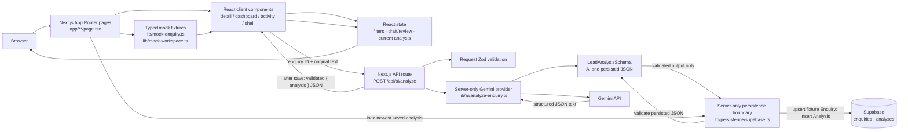
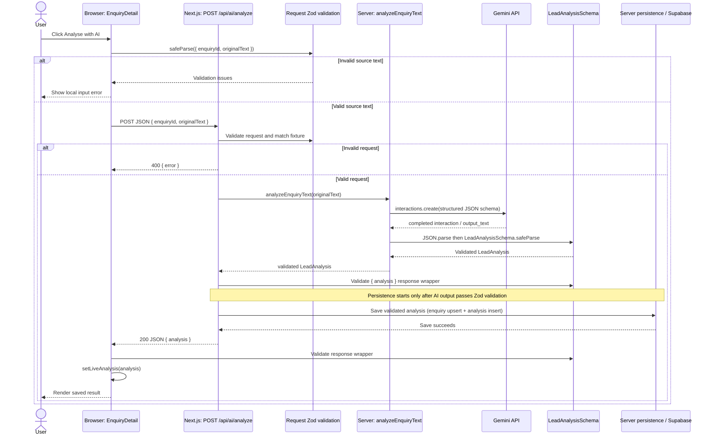

# Architecture walkthrough

This guide describes the implementation in this repository now. It is not a claim that the complete future V1 workflow in [PROJECT_SPEC.md](PROJECT_SPEC.md) already exists. Stage 2B adds Supabase persistence for validated AI analyses; fixture-driven queue/activity data and mock review controls remain.

## 1. Big picture

The current application combines fixture-driven workspace screens with a persisted AI analysis flow:

1. **Fixture enquiry and activity data** in `lib/mock-enquiry.ts` and `lib/mock-workspace.ts` still seed queue rows, detail-page enquiry fields, and the workspace activity feed.
2. **AI analysis** runs from `EnquiryDetail` through `POST /api/ai/analyze` to Gemini. Structured output is parsed and validated with Zod, then saved to Supabase.
3. **Restored analysis** is loaded by the server detail route on a later visit or refresh, validated again as persisted JSON, and passed to `EnquiryDetail`.

Client React state still holds filters, editing/review presentation, and the just-completed analysis while the component is mounted. It is not the durable copy of an AI result: a subsequent visit initializes the component from the newest saved Analysis. Activity history remains a separate seeded fixture feed.



The dashboard queue and activity feed remain fixture-driven. The detail page starts with fixture enquiry fields, but the saved analysis takes precedence when present. The API route persists only after provider output has passed `LeadAnalysisSchema` validation.

The browser communicates with the Next.js server, not directly with either external service. `GEMINI_API_KEY` and `SUPABASE_SECRET_KEY` are server-only and are not passed as props or returned in API responses. Supabase RLS remains enabled; Stage 2B grants only the `service_role` the table privileges required by server persistence, with no `anon` or `authenticated` table grants. Database/provider failures are logged server-side without enquiry contents or credentials; public API errors use safe messages.

## 2. Exact “Analyse with AI” execution chain

The implemented path is:

```text
User clicks “Analyse with AI”
↓
EnquiryDetail validates { enquiryId, originalText } and POSTs to /api/ai/analyze
↓
Next.js route validates the request and matches ID + source text to a fixture
↓
analyzeEnquiryText(originalText) sends a structured-output request to Gemini
↓
Provider parses Gemini output and validates it with LeadAnalysisSchema
↓
Route validates the { analysis } response wrapper
↓
lib/persistence/supabase.ts upserts the fixture Enquiry and inserts the validated Analysis
↓
Route returns the validated response
↓
EnquiryDetail validates the response and updates liveAnalysis in React state
```

### Step-by-step with execution location and data

1. **Click — browser.** The analyze button in `EnquiryDetail` calls `runAnalysis()`. The component has the current enquiry as its `enquiry` prop; the detail route obtained that object from the mock fixture list.
2. **Validate the request — browser.** `runAnalysis()` calls `AnalyzeEnquiryRequestSchema.safeParse({ enquiryId: enquiry.id, originalText: enquiry.originalText })`. This checks the fixture ID and catches empty or overlong text before sending a request.
3. **Send source text — browser to server.** The client posts JSON containing `enquiryId` and `originalText`; contact details are not sent separately.
4. **Validate at the boundary — server.** `POST()` parses and validates the body, then requires the ID and original text to match a current fixture enquiry. Browser validation is only a UX aid.
5. **Call the provider — server.** The route invokes `analyzeEnquiryText()` with the trusted fixture text. The provider reads `GEMINI_API_KEY` and `GEMINI_MODEL` and calls Gemini's `interactions.create()`.
6. **Request and validate structured output — server.** Gemini receives a JSON response schema derived from `LeadAnalysisSchema`. The provider requires a completed interaction, parses `output_text`, and validates the unknown result with `LeadAnalysisSchema.safeParse()`.
7. **Validate the API response — server.** The route validates `{ analysis }` with `AnalyzeEnquiryResponseSchema`.
8. **Persist validated output — server.** Only after output validation succeeds, the route calls `saveValidatedAnalysis()`. The persistence module validates the analysis again, upserts the fixture Enquiry, and inserts a validated Analysis row.
9. **Return and store the result — server to browser.** Only after persistence succeeds does the route return JSON `{ analysis }`. The client parses the response as `unknown`, validates success/error contracts, and calls `setLiveAnalysis()`.
10. **Render — browser.** React displays the current validated analysis. When nullable identity values are absent, the component uses the fixture identity as a fallback.



Persistence errors use the stable `persistence_unavailable` API error and prevent a success-shaped response; they do not put an unsaved result into client state. The client presents the returned safe message where it can validate the error payload, and otherwise shows a generic retryable message. The loading flag is cleared in `finally`.

## 3. Important files, one by one

### `app/layout.tsx`

**Purpose:** Root App Router layout. Imports global CSS and defines page metadata and the outer HTML document.

**Called by:** Next.js for routes under `app/`.

**Calls / depends on:** `app/globals.css`; Next.js `Metadata` and `LayoutProps` types.

**Important exports/functions/components:** `metadata`; `RootLayout`.

**Data in:** `children`, supplied by the active route tree.

**Data out:** `<html lang="en"><body>…</body></html>` around the route.

**Runs where:** Next.js server rendering.

**Why it exists:** The root layout is the shared document shell; individual pages provide route content.

### `app/page.tsx`

**Purpose:** Implements `/` as a redirect to `/dashboard`.

**Called by:** A request or navigation to `/`.

**Calls / depends on:** `redirect` from `next/navigation`.

**Important exports/functions/components:** `Home`.

**Data in:** No application data.

**Data out:** A redirect response to `/dashboard`.

**Runs where:** Next.js server.

**Why it exists:** Keeps `/dashboard` as the application's default workspace view.

### `app/dashboard/page.tsx`

**Purpose:** Route page for the Overview triage queue.

**Called by:** A request/navigation to `/dashboard`.

**Calls / depends on:** `WorkspaceShell` and `EnquiryDashboard`.

**Important exports/functions/components:** `DashboardPage`.

**Data in:** No fetched data; the dashboard component reads mock fixtures.

**Data out:** The shared shell containing `EnquiryDashboard` with `view="overview"`.

**Runs where:** Page composition runs as a Next.js Server Component; the imported interactive components run client-side.

**Why it exists:** Separates route composition from reusable queue rendering.

### `app/enquiries/page.tsx`

**Purpose:** Route page for the full enquiries queue.

**Called by:** A request/navigation to `/enquiries`.

**Calls / depends on:** `WorkspaceShell` and `EnquiryDashboard`.

**Important exports/functions/components:** `EnquiriesPage`.

**Data in:** No fetched data; `EnquiryDashboard` reads fixtures.

**Data out:** The queue configured with `view="enquiries"` (initially showing all statuses).

**Runs where:** Server Component composition plus client-rendered interactive children.

**Why it exists:** Reuses the queue UI with a different initial view instead of duplicating the list.

### `app/enquiries/[id]/page.tsx`

**Purpose:** Resolves a detail URL such as `/enquiries/ENQ-2048` to its fixture Enquiry and loads its newest saved AI Analysis.

**Called by:** A request/navigation to a dynamic enquiry detail URL.

**Calls / depends on:** `mockEnquiries`, `getLatestAnalysis()` from `lib/persistence/supabase.ts`, `WorkspaceShell`, `EnquiryDetail`, and Next.js `notFound()`.

**Important exports/functions/components:** `generateStaticParams()` returns IDs from the fixtures; `EnquiryPage()` awaits `params`, finds the matching fixture, calls `notFound()` if none exists, uses `connection()` so saved state is read for each visit, then loads the latest saved analysis. Known Supabase configuration/read errors are logged safely and passed to the UI as a persistence warning.

**Data in:** The dynamic `id` route parameter.

**Data out:** A `WorkspaceShell` containing `EnquiryDetail` with the selected fixture `WorkspaceEnquiry`, `initialAnalysis` (validated persisted data or `null`), and an optional persistence error.

**Runs where:** Next.js server. `generateStaticParams()` supplies known fixture IDs, while `connection()` keeps the per-visit persistence query out of build-time rendering.

**Why it exists:** Keeps fixture lookup and database access server-side, then gives the interactive detail component both the stable source enquiry and the validated saved result.

### `app/activity/page.tsx`

**Purpose:** Route page for workspace activity history.

**Called by:** A request/navigation to `/activity`.

**Calls / depends on:** `WorkspaceShell` and `ActivityHistory`.

**Important exports/functions/components:** `ActivityPage`.

**Data in:** No fetched data; the activity component reads seeded events.

**Data out:** The shared shell containing the client-side activity feed.

**Runs where:** Server Component composition plus client component behavior.

**Why it exists:** Keeps route composition separate from the filterable history UI.

### `components/workspace-shell.tsx`

**Purpose:** Shared navigation and visual shell around route content.

**Called by:** The dashboard, enquiries, activity, and enquiry detail route pages.

**Calls / depends on:** Next.js `usePathname()` and `Link`; React `useState`; Lucide icons.

**Important exports/functions/components:** `WorkspaceShell` reads the current path to select active navigation/breadcrumbs and owns `mobileNavOpen` for the responsive menu.

**Data in:** `children` as `ReactNode`, usually page content composed by a Server Component.

**Data out:** Sidebar, top bar, mobile navigation, and a main region containing those children.

**Runs where:** Browser, because the module starts with `"use client"` and uses pathname and React state.

**Why it exists:** Centralizes workspace navigation/layout while letting route pages provide their own content.

### `components/enquiry-dashboard.tsx`

**Purpose:** Renders both the Overview attention queue and the full Enquiries list.

**Called by:** `app/dashboard/page.tsx` and `app/enquiries/page.tsx`.

**Calls / depends on:** `mockEnquiries`; Next.js `Link`; local React state; icons.

**Important exports/functions/components:** `EnquiryDashboard({ view })`; `QueueFilter`; `formatReceivedAt()`.

**Data in:** Optional `view` prop (`"overview"` or `"enquiries"`), and mock records from `mockEnquiries`.

**Data out:** Filtered display rows that link to `/enquiries/[id]`; it does not fetch or mutate records.

**Runs where:** Browser (`"use client"`), because search input and filter selection are interactive.

**Why it exists:** One client component serves two queue routes. `view` selects the initial status filter; search and selected filter are local state. “Attention” means all workflow statuses except `"responded"`.

### `components/enquiry-detail.tsx`

**Purpose:** Main enquiry review screen: identity, analysis, source message, proposed draft, and local review history.

**Called by:** `app/enquiries/[id]/page.tsx`, which passes a fixture as `enquiry`.

**Calls / depends on:** `WorkspaceEnquiry`, `ActivityEvent`, shared request/response/error schemas, `LeadAnalysis`; same-origin `fetch("/api/ai/analyze")`; `initialAnalysis` and `persistenceError` props; local React state; Next.js `Link`.

**Important exports/functions/components:** `EnquiryDetail` initializes `liveAnalysis` from `initialAnalysis`; `runAnalysis()` validates the request, calls the API, validates the response, then replaces local result state after server persistence succeeds; `updateAction()` changes only local approval/cancel presentation. Helpers format display values; `InfoTile` and `TimelineItem` render repeated UI structures.

**Data in:** A `WorkspaceEnquiry` fixture, optional Zod-validated `initialAnalysis` loaded from Supabase, and an optional persistence warning.

**Data out:** Review UI. A newly generated analysis enters local state only after the route confirms persistence; a restored analysis initializes that same state on later visits. Enquiry details, draft/review interactions, and per-enquiry timeline events remain fixture/local presentation data.

**Runs where:** Browser (`"use client"`), because it owns button events, request loading/errors, editing, and local review interactions.

**Why it exists:** It is the interaction boundary for one enquiry. AI transport and persistence are delegated to server modules; the component renders saved analysis alongside fixture enquiry data and retains temporary interaction state.

### `components/activity-history.tsx`

**Purpose:** Renders the workspace-wide seeded activity feed.

**Called by:** `app/activity/page.tsx`.

**Calls / depends on:** `mockWorkspaceActivity`, `mockEnquiries`, `WorkspaceActivityType`; local React filter state; Next.js links.

**Important exports/functions/components:** `ActivityHistory`; `matchesFilter()` defines event categories; `eventPresentation` maps event types to icons/styles; `formatDate()` and `formatTime()` produce labels.

**Data in:** Seeded workspace events and seeded enquiries used to resolve event links.

**Data out:** Events filtered by type, sorted newest-first, grouped by date, and linked to matching enquiry details where possible.

**Runs where:** Browser (`"use client"`), as the activity filter is interactive.

**Why it exists:** Keeps the history view separate from per-enquiry detail interactions. Its source array is fixture data, not a live event store.

### `app/api/ai/analyze/route.ts`

**Purpose:** Server-side HTTP boundary for analysis requests.

**Called by:** The browser's `fetch("/api/ai/analyze")` from `EnquiryDetail.runAnalysis()`.

**Calls / depends on:** `AnalyzeEnquiryRequestSchema`, `AnalyzeEnquiryResponseSchema`, `AnalyzeEnquiryErrorSchema`; `analyzeEnquiryText()`, `saveValidatedAnalysis()`, and their typed errors.

**Important exports/functions/components:** `POST(request)` parses and validates input, matches enquiry ID and text to a fixture, runs analysis, validates the response wrapper, persists the validated analysis, and only then returns JSON. `errorResponse()` ensures errors use the typed `{ error: { code, message } }` shape, including `persistence_unavailable`.

**Data in:** An HTTP JSON request containing `enquiryId` and `originalText`.

**Data out:** Success only after save: `{ analysis: LeadAnalysis }`. Invalid JSON/request: HTTP 400. Missing provider or persistence configuration, or persistence failure: HTTP 503. Provider/output failures: HTTP 502 with a safe public message.

**Runs where:** Next.js server route handler, not in the browser.

**Why it exists:** It prevents the browser from needing provider or database credentials, validates untrusted incoming requests, orders persistence after output validation, and keeps provider/database errors behind a stable application response contract.

### `lib/ai/analyze-enquiry.ts`

**Purpose:** Implements the Gemini provider boundary for one enquiry analysis.

**Called by:** `POST()` in `app/api/ai/analyze/route.ts`.

**Calls / depends on:** `@google/genai` (`GoogleGenAI`, `ApiError`); Zod's `toJSONSchema()`; `LeadAnalysisSchema` and `LeadAnalysis`.

**Important exports/functions/components:** `analyzeEnquiryText(originalText)` reads server environment variables, submits the request, checks/parses output, and returns validated analysis. `AnalysisConfigurationError` signals missing key/model; `AnalysisOutputError` signals unavailable, malformed, or schema-invalid output.

**Data in:** `originalText` from the validated API request; `GEMINI_API_KEY` and `GEMINI_MODEL` from the server environment.

**Data out:** A `LeadAnalysis` value only after successful Zod validation.

**Runs where:** Next.js server only. The module imports `"server-only"` and must not be imported into client components.

**Why it exists:** Keeps provider SDK calls and the secret key out of the UI and route implementation. It also owns structured-output configuration and provider retry policy.

**Current provider behavior:** The model is read from `GEMINI_MODEL`; `.env.example` sets the development example to `gemini-3.5-flash-lite`. The provider does not silently substitute a model if this environment variable is missing. Thinking is set to `"minimal"`. The request has a 30-second SDK timeout and SDK retries are disabled. The provider retries only `ApiError` HTTP statuses 429, 500, 502, 503, and 504, up to two retries after the first attempt, waiting 500 ms and then 1,000 ms. Authentication, bad-request, schema, and non-HTTP errors are not retried. Development logs include only model, attempt, and elapsed milliseconds.

### `lib/persistence/supabase.ts`

**Purpose:** Owns the server-only Supabase boundary for saving validated analyses and restoring the newest saved analysis.

**Called by:** `POST()` in `app/api/ai/analyze/route.ts` calls `saveValidatedAnalysis()` after AI output and response validation; `app/enquiries/[id]/page.tsx` calls `getLatestAnalysis()` on each visit.

**Calls / depends on:** `@supabase/supabase-js`; `SUPABASE_URL` and `SUPABASE_SECRET_KEY`; `WorkspaceEnquiry`; `LeadAnalysisSchema` and `parsePersistedAnalysis()`.

**Important exports/functions/components:** `saveValidatedAnalysis()` checks the analysis again, idempotently upserts the fixture Enquiry (ignoring duplicates), then inserts an Analysis with `status: "validated"` and JSONB model output. `getLatestAnalysis()` queries by enquiry ID, newest `created_at` first, and validates the JSON before returning it. Configuration and operation failures use typed errors.

**Runs where:** Next.js server only. The module imports `"server-only"`; its privileged credential and client are never sent to the browser.

**Why it exists:** Centralizes database access and validation of saved JSON. Database diagnostics are logged without enquiry data or credentials; the API returns safe error messages.

### Supabase migrations

`supabase/migrations/20261007130000_enquiries_and_analyses.sql` creates `enquiries` and `analyses`, their constraints and latest-analysis index, enables RLS, grants schema usage to `service_role`, and grants only that role the initial server-required table privileges. `supabase/migrations/20261007140000_grant_enquiries_select.sql` adds `SELECT` on `enquiries`: PostgREST upsert needs SELECT privilege as well as INSERT for the server's conflict-handling operation. Neither migration adds table grants for `anon` or `authenticated`.

The Supabase project has its Data API enabled and automatic table exposure disabled. Explicit `service_role` grants allow the server flow to use the Data API while RLS remains enabled; the browser does not query these tables.

### `lib/lead-analysis-schema.ts`

**Purpose:** Defines the application validation contract shared by the browser and server.

**Called by:** API route, provider, enquiry detail component, persistence module, and schema/persistence tests.

**Calls / depends on:** Zod.

**Important exports/functions/components:** `LeadAnalysisSchema` defines company/contact/project fields; nullable budget and timeline facts; bounded priority and score; requirements; missing information; qualification summary; and recommended next step. The nested analysis objects and outer analysis schema are strict. `parsePersistedAnalysis()` applies that same contract to untrusted stored JSON. `AnalyzeEnquiryRequestSchema` validates the enquiry ID and trims/limits text to 1–12,000 characters. `AnalyzeEnquiryResponseSchema` validates the `{ analysis }` wrapper; `AnalyzeEnquiryErrorSchema` validates the safe error wrapper. `LeadAnalysis` is inferred with `z.infer<typeof LeadAnalysisSchema>`.

**Data in:** Unknown JavaScript values from Gemini, HTTP payloads, and persisted JSON.

**Data out:** Parse results (success with typed data or failure with issues); the inferred `LeadAnalysis` TypeScript type.

**Runs where:** Both browser and server. The client validates request/response/error payloads; the server validates requests and AI results, and the persistence module validates both before save and after restore.

**Why it exists:** One runtime schema and inferred type keep validation and TypeScript shapes aligned. The provider also derives Gemini's JSON Schema from this source of truth.

### `lib/mock-enquiry.ts`

**Purpose:** Defines the base `MockEnquiry` shape, reusable fixture item types, and one complete sample enquiry.

**Called by:** `lib/mock-workspace.ts` uses the sample as a base; detail-related types consume its declared interfaces.

**Calls / depends on:** `LeadAnalysis` types for requirement and missing-information item shapes.

**Important exports/functions/components:** `Requirement`, `MissingInformation`, `ActivityEvent`, `MockEnquiry`, and `mockEnquiry`.

**Data in:** No runtime external data.

**Data out:** A representative fixture including original text, prefilled analysis-like display fields, a draft reply, and per-enquiry activity.

**Runs where:** Imported in both server page composition and client components; it is static module data.

**Why it exists:** Gives the mock UI a typed example and keeps fixture definitions separate from rendering.

### `lib/mock-workspace.ts`

**Purpose:** Defines workflow-oriented types and the queue/activity fixtures for the workspace.

**Called by:** Dashboard, activity history, and dynamic detail route.

**Calls / depends on:** Spreads and extends `mockEnquiry`.

**Important exports/functions/components:** `WorkspaceEnquiry` extends `MockEnquiry` with source, summary, workflow/analysis statuses, optional action state/outcome, and an ISO timestamp. `mockEnquiries` is the detail/queue record set. `WorkspaceActivityEvent` and `mockWorkspaceActivity` provide the separate workspace history feed.

**Data in:** The base `mockEnquiry` object, overridden to create the other examples.

**Data out:** Typed arrays consumed as initial UI data.

**Runs where:** Server and client as imported by route files and client components.

**Why it exists:** Separates the workspace's seeded records and event taxonomy from both shared display types and UI. These are not database records; the activity feed is not automatically updated by detail-page state changes.

### `tests/lead-analysis-schema.test.mjs`

**Purpose:** Focused Node tests for `LeadAnalysisSchema`.

**Called by:** `yarn test:analysis`.

**Calls / depends on:** Imports the schema from `lib/lead-analysis-schema.ts` and uses Node's test/assert APIs.

**Important exports/functions/components:** Tests complete analysis acceptance, nullable source data, arbitrary/null project types, score bounds, and allowed priority values.

**Data in:** Example JavaScript analysis objects.

**Data out:** Pass/fail results. This test file does not call the Gemini API or test the API route/retry flow.

**Runs where:** Node test process, outside the browser.

**Why it exists:** Verifies the core runtime model independently of UI and provider availability.

### `tests/persisted-analysis.test.mjs`

**Purpose:** Focused Node tests for validating stored Analysis JSON.

**Called by:** `yarn test:persistence`.

**Calls / depends on:** `parsePersistedAnalysis()` from `lib/lead-analysis-schema.ts`; Node's test/assert APIs.

**What it verifies:** A valid analysis object can be restored, while malformed or schema-extended stored JSON is rejected. It does not connect to Supabase or test network persistence.

### Verification status

The current implementation has analysis-schema tests and persisted-analysis tests. Lint, typecheck, and production build pass. The live Supabase round-trip has also been manually verified: AI analysis was generated, saved, observed in Supabase, and restored after refreshing the page. That live check is not an automated database integration test.

### `README.md`, `.env.example`, and `.gitignore`

**Purpose:** Document local Gemini setup and keep local secrets out of source control.

**Called by:** Developers while configuring/running the app; `.gitignore` is applied by Git.

**Calls / depends on:** `.env.example` names `GEMINI_API_KEY`, `GEMINI_MODEL`, `SUPABASE_URL`, and `SUPABASE_SECRET_KEY`; `README.md` explains server-side setup; `.gitignore` ignores `.env*` but permits `.env.example`.

**Important exports/functions/components:** None; these are setup files.

**Data in:** Developer-provided environment configuration.

**Data out:** A documented environment setup. Actual values are loaded from the local environment by Next.js and read by server code.

**Runs where:** Documentation/Git tooling; environment values are made available to Next.js server runtime.

**Why it exists:** Keeps setup instructions separate from runtime code and reduces the risk of committing `.env.local`. The Supabase secret key must remain server-only and must not use a `NEXT_PUBLIC_` prefix.

## 4. React state and what survives refresh

Keep these four data/state categories separate:

1. **Fixture enquiry data** seeds queue rows and the detail page's source/contact fields; the activity page remains a separately seeded fixture feed.
2. **Persisted AI Analysis** is the validated record stored in Supabase. This is the durable result for an enquiry.
3. **Temporary local React state** holds a newly completed analysis after the API returns success, along with local filters and draft/review presentation. A successful response is returned only after the Analysis has been saved.
4. **Server-loaded persisted analysis** is queried and validated on each later detail-page visit, then passed as `initialAnalysis` to `EnquiryDetail`.

### `EnquiryDashboard`

- `filter` begins as `"attention"` on the overview and `"all"` on the full enquiries route. The `key` props in those route pages ensure the shared component gets distinct initial state when switching route identity.
- `query` stores the search input.
- `visibleEnquiries` is derived on each render by filtering `mockEnquiries` by status and searchable text.
- Both states are in the browser only. Refresh restores the route's initial filter and an empty search string.

### `ActivityHistory`

- `filter` begins as `"all"` and changes when the user selects an activity category.
- Sorted, filtered, grouped events and the enquiry lookup map are derived from static arrays; they are not persisted.
- Refresh restores `"all"` and reloads the same seeded history.

### `WorkspaceShell`

- `mobileNavOpen` controls only whether its responsive navigation is visible.
- Active navigation and breadcrumb values derive from `usePathname()`, not a separate saved state.
- A route transition or refresh does not persist an open-menu setting.

### `EnquiryDetail`

- Initial `enquiry` data comes from `mockEnquiries` selected in the server route.
- `actionState`, `draftBody`, and `events` start from the fixture and change locally through approval, cancellation, and editing interactions.
- `liveAnalysis` starts from the server-provided `initialAnalysis` (or `null`). A successful `/api/ai/analyze` response replaces it after the server has persisted the validated result.
- `isAnalyzing` drives the loading UI; `analysisError` holds a message for the current request.
- The analysis fields shown are derived from the live object when present, otherwise from the fixture. Some nullable live values intentionally display as “Not identified” or “Not provided” rather than returning to a seeded analysis value.
- The proposed email is just display/edit state. Clicking approve or cancel updates local status and the detail-page timeline; it does not send email, call another route, or update `mockWorkspaceActivity`.

Only the fixture/local UI state is reset on refresh: filters return to defaults, draft/review changes return to fixture values, and local timeline edits disappear. The analysis result is different: `app/enquiries/[id]/page.tsx` performs a server-side query for the newest Analysis, validates its JSON with `parsePersistedAnalysis()`, and supplies it to the remounted component. Thus the saved analysis survives refresh, while the activity feed remains fixture-driven and does not record detail-page review changes.

## 5. The AI boundary and environment

The external-service paths are:

```text
Browser → Next.js server → Gemini
Enquiry detail page → Next.js server → Supabase
```

`EnquiryDetail` knows only the same-origin `/api/ai/analyze` endpoint and the response schemas. `app/api/ai/analyze/route.ts` validates the request, calls the provider, and persists the validated result before responding. The detail page calls the server-only persistence module to restore saved state. `lib/ai/analyze-enquiry.ts` and `lib/persistence/supabase.ts` are both server-only. The browser never receives either the Gemini API key or the Supabase secret key.

The server reads `GEMINI_API_KEY` and `GEMINI_MODEL` for Gemini, and `SUPABASE_URL` plus `SUPABASE_SECRET_KEY` for persistence. The Supabase key is server-only, is not prefixed `NEXT_PUBLIC_`, and is not included in requests, page props, or API responses. `.env.example` lists variable names only; real values belong in ignored `.env.local` or another server environment. A missing Gemini key/model maps to `503 missing_configuration`; missing Supabase configuration or persistence failure maps to `503 persistence_unavailable`.

The Supabase Data API is enabled with automatic table exposure disabled. RLS is enabled on both tables. The migrations grant required access to `service_role` only; this Stage 2B flow adds no `anon` or `authenticated` table grants. The browser does not query Supabase directly. Provider/database diagnostics remain on the server and omit enquiry contents and credentials; public error messages use the stable API contract.

The provider retries known transient HTTP API errors only: 429 and selected 5xx statuses (500, 502, 503, 504). These commonly represent rate limiting or temporary service trouble. It makes at most three calls total (initial attempt plus two retries), with short increasing delays. Other failures such as authentication or malformed requests cannot be fixed by repeating the same request, so they fail immediately. Model output validation failures happen after the provider call and are not part of this retry loop.

In development, timing logs report model name, attempt number, and elapsed milliseconds. They do not log the key, enquiry, or model output. The API route has separate server-side provider diagnostics; browser-facing errors remain generic or schema-defined.

## 6. Zod and structured AI output

`LeadAnalysisSchema` in `lib/lead-analysis-schema.ts` is the runtime source of truth for a valid analysis. It describes required fields and constraints such as nullable unknown facts, allowed priority values, numeric lead score between 0 and 100, and strict nested objects. `LeadAnalysis` is inferred from that schema, so TypeScript consumers use the same field structure that runtime validation enforces.

The provider converts the schema for Gemini and then still validates Gemini's answer:

```text
LeadAnalysisSchema (Zod)
↓ z.toJSONSchema(..., { target: "draft-7" })
JSON Schema passed as response_format.schema
↓
Gemini structured JSON output in output_text
↓ JSON.parse()
unknown JavaScript value
↓ LeadAnalysisSchema.safeParse()
validated LeadAnalysis
```

The exact Gemini request sets `response_format` to text with `mime_type: "application/json"` and supplies the JSON Schema. That asks the model to constrain output to the structured shape; it does not make external output inherently trustworthy. The response still crosses a network/provider boundary and can be absent, malformed, or violate application constraints. `JSON.parse()` checks JSON syntax; it does not check field types or business constraints. `safeParse()` performs that second check and produces a typed value only on success.

The route also validates `{ analysis }` with `AnalyzeEnquiryResponseSchema` before returning. The browser parses the response as `unknown` and validates the same wrapper before storing it. These checks guard distinct boundaries: Gemini-to-provider, provider-to-route, and server-to-client.

## 7. Next.js concepts used here

- **App Router:** The `app/` directory maps files to routes. This project has `/`, `/dashboard`, `/enquiries`, `/enquiries/[id]`, `/activity`, and `/api/ai/analyze`.
- **`page.tsx`:** Route UI entry points are in `app/**/page.tsx`. They are Server Components by default. Here they compose the shell and client components, rather than owning interactive state.
- **Dynamic route:** `app/enquiries/[id]/page.tsx` uses the `[id]` folder to capture an enquiry ID. It awaits Next.js's `params` promise, selects a matching mock record, and uses `notFound()` when no fixture matches. `generateStaticParams()` exposes the existing fixture IDs; `connection()` ensures the saved-analysis query runs at request time.
- **API `route.ts`:** `app/api/ai/analyze/route.ts` exports `POST()`, which handles an HTTP request. This is separate from page rendering and is the server endpoint called by the browser.
- **Client components:** `components/enquiry-detail.tsx`, `components/enquiry-dashboard.tsx`, `components/activity-history.tsx`, and `components/workspace-shell.tsx` start with `"use client"` because they use state, event handlers, browser fetch, or client navigation state.
- **Server/client composition:** Route pages remain server-side and pass fixture props, validated `initialAnalysis`, persistence status, and/or children to client components. `WorkspaceShell` accepts `children`, allowing each route to reuse the client shell while supplying its own page content.
- **Server-only integrations:** `lib/ai/analyze-enquiry.ts` and `lib/persistence/supabase.ts` import `"server-only"` to prevent accidental client use. They access private environment variables and their respective service SDKs.
- **Root layout:** `app/layout.tsx` provides the shared document, global stylesheet import, and metadata. `app/page.tsx` uses Next's `redirect()` to send the root route to the dashboard.

## 8. Recommended reading order

1. **`app/enquiries/[id]/page.tsx`** — Follow fixture lookup, request-time database load, and `initialAnalysis` props.
2. **`lib/persistence/supabase.ts`** — Understand the save/upsert path and latest-analysis restore query.
3. **`components/enquiry-detail.tsx`** — Follow restored analysis, temporary React state, and the analyze interaction.
4. **`app/api/ai/analyze/route.ts`** — Trace request validation, AI validation, persistence ordering, and response.
5. **`lib/ai/analyze-enquiry.ts`** — Read the server-only Gemini request, structured-output config, retries, and Zod validation.
6. **`lib/lead-analysis-schema.ts`** — Learn the shared contracts, including validation of stored JSON.
7. **`supabase/migrations/20261007130000_enquiries_and_analyses.sql`** and **`supabase/migrations/20261007140000_grant_enquiries_select.sql`** — Review the tables, RLS, and server-role grants.
8. **`lib/mock-workspace.ts`** and **`lib/mock-enquiry.ts`** — Compare fixture enquiry/activity data with persisted Analysis data.
9. **`components/enquiry-dashboard.tsx`** and **`components/activity-history.tsx`** — See which screens remain fixture-driven.
10. **`components/workspace-shell.tsx`** — See shared navigation and its local state.
11. **`tests/lead-analysis-schema.test.mjs`** and **`tests/persisted-analysis.test.mjs`** — Review automated schema and stored-JSON tests; neither calls Gemini or Supabase.
12. **`app/dashboard/page.tsx`, `app/enquiries/page.tsx`, `app/activity/page.tsx`, `app/layout.tsx`, and `app/page.tsx`** — Review the remaining route composition and root layout/redirect.

## 9. Current architecture versus future work

### Current implementation

```text
fixture enquiry
       ↓
React client → POST /api/ai/analyze
       ↓
Next.js server → Gemini structured output
       ↓
Zod validation → Supabase persistence
       ↓
validated response → temporary EnquiryDetail React state
       ↓ later visit / refresh
server-side Supabase query → persisted JSON Zod validation
       ↓
EnquiryDetail restores saved analysis
```

The queue and activity feed remain fixture-based. Enquiry detail source fields also come from fixtures; persisted Analysis is separate from those records. Search, filters, draft editing, approval/cancellation states, and per-enquiry timeline changes are local presentation behavior. No email is sent and no action is executed.

### Future architecture

Persistence of the validated Analysis is current. The following Action/tool workflow remains future work; Action execution, email, and durable `ActivityEvent` records are not implemented:

```text
validated analysis
       ↓
Action proposal → application-side validation
       ↓
human approval
       ↓
approved tool/function execution
       ↓
email / external API
       ↓
persisted ActivityEvent
```

Treat this second diagram as future scope only. Current detail-page approval controls remain local presentation and are not connected to execution.
